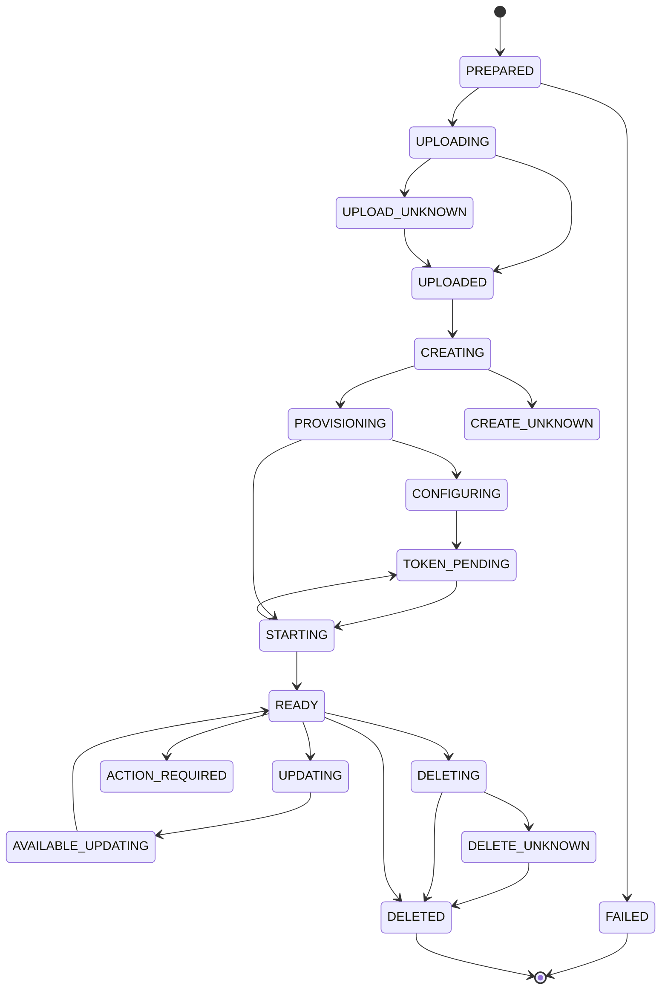

**A managed runtime is driven by a platform YAML declaration; Studio does not edit the Agent inside the container, it projects the declaration into one DSH launch.** The declaration format is fixed at `agentengine.dsh-manifest/v1`, capped at 900 KiB, and accepts exactly 8 fields (`src/managed-runtime-manifest.mjs:9-12`).

## The declaration contract

| Item | Value | Source |
| --- | --- | --- |
| Format | `agentengine.dsh-manifest/v1` | `src/managed-runtime-manifest.mjs:9` |
| Size cap | 900 KiB (`900 * 1024` bytes) | `:10`, `:28` |
| Allowed fields | `name`, `description`, `framework`, `artifact_type`, `runtime`, `model`, `prompt`, `resources` | `:12` |
| `framework` values | `dsh-native`, `harness`, `codex` | `:11` |
| `runtime` shape | Exactly the `name` and `version` keys | `:44` |
| `artifact_type` | Must be `ManagedRuntime` | `:46` |
| Runtime profile | `agentkit-runtime` | `src/runtime-host-installation.mjs:12` |
| Base bundles | `@deepseek-ai/dsh-base`, `@deepseek-ai/dsh-web-app`, `@kingsoftcloud/agentkit-studio` | `:19` |

<Callout type="error" title="No inline credentials in a declaration">
  `mcp_servers` credentials can only reference deployment environment variables through `env_refs`; values are injected separately at deployment time. Inline credentials, query strings, fragments and backslashes are all rejected (`src/managed-resource-contract.mjs`). Any Agent write inside the container returns `MANAGED_RUNTIME_READ_ONLY` (`src/managed-runtime-definition.mjs:79`).
</Callout>

## The main path: submission to ready

Start with the shortest route. This diagram has seven steps and three exits — it places most day-to-day questions.

<Diagram src="/assets/agentkit-deploy-main.en.png" alt="Deployment main path: PREPARED → UPLOADING → UPLOADED → CREATING → PROVISIONING → STARTING → READY, plus the FAILED, UPLOAD_UNKNOWN and CREATE_UNKNOWN exits" />

*How to read it: once a deployment reaches `FAILED` that attempt is over — fix the cause and create again, it does not retry in place. Reaching a `*_UNKNOWN` means the platform did not confirm the outcome, so reconcile before acting.*

## The full state tree: 19 states, 26 transitions

Updates, rollbacks, deletion and every branch live here. States are grouped by what you should do next, not by internal order.

<Diagram src="/assets/agentkit-deploy-states.en.png" alt="Full state tree of the 19 deployment states: the main path is PREPARED → UPLOADING → UPLOADED, the remaining states unfold by operator intent, including the direct READY → DELETED edge and the reconciliation loops of the four UNKNOWN states" />

*How to read this: grouping is by "what should you do next", not by internal ordering. The four `*_UNKNOWN` states have a fixed meaning — the platform did not confirm the outcome, so they are neither failure nor success, and the only correct action is to reconcile before acting. Treating one as a failure and retrying submits a paid operation twice.*

Below is the precise transition list for the same machine, for cross-checking against code:

Source: `src/studio-deployments.mjs:268-430`, `src/client/state/deployment.mjs:1`. State names match the strings in code exactly — do not translate them, because they appear in API responses.

## What you can do in each state

| State | Label | Meaning | What you can do | Auto-poll |
| --- | --- | --- | --- | :--: |
| `PREPARED` | Pending submit | Record exists, bundle not uploaded | Submit as-is, or delete the record | No |
| `UPLOADING` | Uploading bundle | Portable bundle in flight | Wait; an interruption becomes `UPLOAD_UNKNOWN` | No |
| `UPLOAD_UNKNOWN` | Upload result unverified | Local flow interrupted, result unknown | Verify in the operations centre; do not re-upload | No |
| `UPLOADED` | Uploaded | Bundle stored, waiting to create the cloud Agent | Wait for creation | No |
| `CREATING` | Creating | Call to CreateAgent in flight | Wait; an interruption becomes `CREATE_UNKNOWN` | No |
| `CREATE_UNKNOWN` | Create result unverified | Creation interrupted, an instance may exist | **Verify in the cloud first**; Studio will not create a duplicate | No |
| `PROVISIONING` | Provisioning instance | Instance or token not ready yet | Wait; a long stay means the key is not ready | Yes |
| `CONFIGURING` | Configuring access token | Writing the API key into `AGENTKIT_RUNTIME_TOKEN` | Wait | Yes |
| `TOKEN_PENDING` | Waiting for the token to take effect | Token written, probe not passing | Wait; a long stay means the env var is masked | Yes |
| `STARTING` | Starting | Instance running, but `/health` or the protocol probe has not passed | Wait; on repeated failure read the operations log | Yes |
| `UPDATING` | Switching version, waiting for the entry point | Platform rolling a version | Wait for the entry point to recover | Yes |
| `UPDATE_UNKNOWN` | Update result unverified | Update interrupted | Verify the cloud version, then decide whether to retry | Yes |
| `READY` | Ready | Health, protocol probe and version all pass | Use it normally | No |
| `AVAILABLE_UPDATING` | Entry point available, platform updating | Entry point up, rollout still in progress | Usable, but avoid hard dependencies | Yes |
| `ACTION_REQUIRED` | Action required | Storage verification and similar need a human | Read `failure.code`, fix, retry | Yes |
| `FAILED` | Failed | The cloud reported a definite failure | Read `failure`, fix, redeploy | No |
| `DELETING` | Deleting | Deletion in flight | Wait | Yes |
| `DELETE_UNKNOWN` | Delete result unverified | Deletion interrupted | Verify in the cloud, then retry deletion | Yes |
| `DELETED` | Deleted | Logically deleted; native bytes are retained | Re-bind when ready | No |

Polling set: `DEPLOYMENT_POLL_STATES` (9 entries). Requires attention: `DEPLOYMENT_ATTENTION_STATES` (7 entries, including `TOKEN_PENDING` and the four `*_UNKNOWN` states). Source: `src/client/state/deployment.mjs:3`, `:5`.

<Callout type="warn" title="The four *_UNKNOWN states are not errors">
  `UPLOAD_UNKNOWN`, `CREATE_UNKNOWN`, `UPDATE_UNKNOWN` and `DELETE_UNKNOWN` all mean **the local flow was interrupted and the cloud result is unknown**. Studio deliberately does not retry automatically, because creating a duplicate instance costs far more than asking you to verify once (`src/studio-deployments.mjs:323`, `:362-363`).
</Callout>

## Platform capability matrix

A managed runtime declares only part of the surface and marks the rest explicitly unavailable rather than silently approximating it:

| Capability | Supported | Mode |
| --- | :--: | --- |
| `submit_interaction` (human approval) | yes | `native` |
| `cancel` / `StopRun` | yes | Native |
| `resume` / `ResumeRun` | no | Explicitly unavailable |
| `background` runs | no | Explicitly unavailable |
| `checkpoint` / `durable_restore` | no | Explicitly unavailable |
| `goal` / `loop` / `plan` | no | Explicitly unavailable |
| `attach` / `steer` / `inject` | no | Explicitly unavailable |
| Attachments and workspace files | no | `Attachments: false`, `WorkspaceFiles: false` |
| Kernel session events | no | `KernelSessionEvents: false` |

Source: `src/managed-runtime-capabilities.mjs:2-30`.

Persistence is declared as `dsh-native-disk` with `SharedAcrossPods: false`, `EffectiveFor: same_agent_version` and `ActiveRunRestore: false` — **resumable within one Agent version, not shared across Pods, and active runs are not restored automatically** (`:28-29`).

## State directory and identity

| Path / item | Purpose | Source |
| --- | --- | --- |
| `<state>/.managed-runtime.json` | Written on first boot, format `agentengine.managed-state/v1` | `src/managed-runtime-host.mjs:289` |
| `<state>/versions/<sha256(versionId)>/.managed-version.json` | Version-scoped immutable receipt, format `agentengine.managed-version/v1` | `:296` |
| `<state>/dsh` | DSH home, **Agent-scoped**, keeping sessions and settings across versions | `:19-24` |
| `<state>/.dsh-adopted.json` | Receipt for adopting a pre-fix version directory | `:22` |
| `agentkit/managed-sessions` | Managed session registry | `:178` |

Reusing one VersionId with different declaration bytes fails: a version is immutable (`:292-296`).

## Authentication and privacy boundary

| Item | Rule | Source |
| --- | --- | --- |
| Runtime token | `AGENTKIT_RUNTIME_TOKEN` is at least 24 characters | `src/managed-runtime-host.mjs:273` |
| Trusted business identity | All four `x-agentengine-*` headers are required; missing returns 401 | `src/managed-runtime-identity.mjs:5-18` |
| Subject identifier | Sort the four identity parts, then SHA-256, prefixed `aeu_` | `:21-24` |
| Version fence | `X-AgentEngine-Target-Version-Id` and `X-AgentEngine-Manifest-Sha256` must match the loaded declaration, otherwise 409 `RUNTIME_DEPLOYMENT_CHANGED` | `src/build-runtime-http.mjs:105` |
| One active run | A session with an active run returns 409 `RUNTIME_SESSION_BUSY` | `:193` |
| Approval timeout | 2 minutes | `src/managed-runtime-approval.mjs:25` |

## Managed Host endpoints

A managed Host listens on a local HTTP port and the platform drives sessions through it. The surface splits into health/identity probes and the Actions under `/agentengine/api/v1/`.

| Method | Path | Purpose |
| --- | --- | --- |
| `GET` | `/health` | Readiness probe: 200 `ready`, 503 `stopping` |
| `GET` | `/v1/agentkit/runtime` | Identity probe: AgentId, VersionId, manifest digest and runtime version |
| `POST` | `/v1/responses`, `/runs` | Model run entry point (Responses transport) |
| `POST` | `/runs/<runId>/cancel`, `/v1/responses/<id>/cancel` | Cancel one run |
| `POST` | `/agentengine/api/v1/<Action>` | Session and history Actions (table below) |

| Action | Required fields |
| --- | --- |
| `GetAgentUiBootstrap` | `Name`, `SessionId` |
| `ListAgentModels` | `Name` |
| `CreateSession` | `SessionId` |
| `GetSession` | `SessionId` |
| `ListSessions` | `Page`, `PageSize` |
| `DeleteSession` | `SessionId` |
| `CancelRun` | `SessionId`, `InvocationId`, `ResponseId`, `ClientToken` |
| `SubmitInteraction` | `SessionId`, `RunId`, `InteractionId`, `ExpectedRevision`, `Action`, `Response`, `IdempotencyKey` |
| `ListSessionMessages` | `SessionId`, `Limit`, `AfterSeqId`, `BeforeSeqId`, `HistoryEpoch`, `SnapshotSeqId`, `CursorSource`, `IncludeReasoning`, `IncludeToolEvents`, `IncludeAttachments` |
| `ListSessionEvents` | As above, plus `EventTypes`, `EventOrder`, `Offset`, `CheckpointIds` |

`AgentId` and `UserId` are always allowed; an unlisted field fails with `RUNTIME_ACTION_INPUT_UNSUPPORTED` and an unknown Action returns 404 `RUNTIME_ACTION_UNSUPPORTED` (`src/managed-runtime-actions.mjs:158-167`, `src/build-runtime-http.mjs:128-132`).

## Related pages

<Cards>
  <Card title="Degradation and retry" href="/en/docs/deployment/degradation-retry">The two strategies when a resource is unreachable</Card>
  <Card title="Runtime comparison" href="/en/docs/deployment/runtimes-compare">How `framework` maps onto a runtime</Card>
  <Card title="Deploy to the cloud" href="/en/docs/guides/deploy-to-cloud">Start a deployment from Studio</Card>
</Cards>
