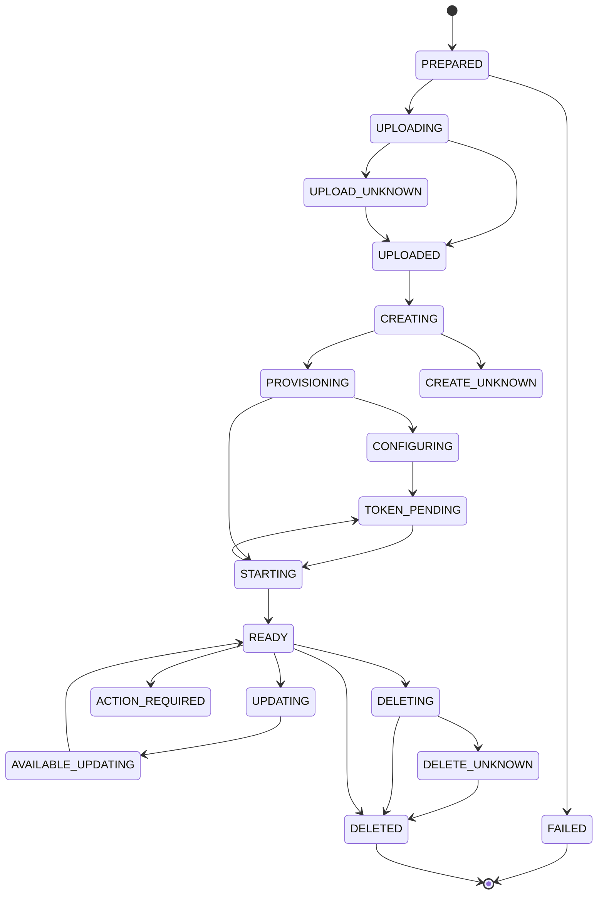

**托管运行时（managed runtime）由平台 YAML 声明驱动，Studio 不在容器里编辑 Agent，只把声明投影成一次 DSH 启动。** 声明格式固定为 `agentengine.dsh-manifest/v1`，上限 900 KiB，只接受 8 个字段（`src/managed-runtime-manifest.mjs:9-12`）。

## 声明契约

| 项 | 值 | 依据 |
| --- | --- | --- |
| 格式 | `agentengine.dsh-manifest/v1` | `src/managed-runtime-manifest.mjs:9` |
| 大小上限 | 900 KiB（`900 * 1024` 字节） | `:10`、`:28` |
| 允许字段 | `name`、`description`、`framework`、`artifact_type`、`runtime`、`model`、`prompt`、`resources` | `:12` |
| `framework` 取值 | `dsh-native`、`harness`、`codex` | `:11` |
| `runtime` 结构 | 只能有 `name` 与 `version` 两个键 | `:44` |
| `artifact_type` | 必须是 `ManagedRuntime` | `:46` |
| 运行 Profile | `agentkit-runtime` | `src/runtime-host-installation.mjs:12` |
| 基础 bundle | `@deepseek-ai/dsh-base`、`@deepseek-ai/dsh-web-app`、`@kingsoftcloud/agentkit-studio` | `:19` |

<Callout type="error" title="声明不接受内联凭证">
  `mcp_servers` 的凭证只能通过 `env_refs` 引用部署环境变量，值在部署时单独注入；内联凭证、查询串、片段与反斜杠都会被拒绝（`src/managed-resource-contract.mjs`）。容器内对 Agent 的写操作一律返回 `MANAGED_RUNTIME_READ_ONLY`（`src/managed-runtime-definition.mjs:79`）。
</Callout>

## 主路径：从提交到就绪

先看最短的那条路。下面这张图只有七步和三处出口——日常排查 90% 的问题都能在这里定位。

<Diagram src="/assets/agentkit-deploy-main.png" alt="部署主路径：PREPARED → UPLOADING → UPLOADED → CREATING → PROVISIONING → STARTING → READY，以及 FAILED、UPLOAD_UNKNOWN、CREATE_UNKNOWN 三处出口" />

*读图要点：一旦落到 `FAILED`，本次尝试就结束了——修因后重建，不能原地重试；落到 `*_UNKNOWN` 则说明平台没有确认结果，先核对再动作。*

## 全状态树：19 个状态与 26 条转移

升级、回滚、删除与所有旁支都在这张图里。分组依据是「你下一步该做什么」，不是内部顺序。

<Diagram src="/assets/agentkit-deploy-states.png" alt="19 个部署状态的全状态树：主路径 PREPARED → UPLOADING → UPLOADED，其余状态按操作意图展开，包含 READY → DELETED 的直接删除边与四个 UNKNOWN 的核对回路" />

四个 `*_UNKNOWN` 的含义固定：平台没有确认结果，它既不是失败也不是成功，唯一动作是先核对再决定；把它当失败重试，会重复提交一次付费操作。

下面是同一台状态机的精确转移列表，用于对照代码：

依据：`src/studio-deployments.mjs:268-430`、`src/client/state/deployment.mjs:1`。状态名与代码中的字符串完全一致，不要翻译它们——它们会出现在 API 响应里。

## 每个状态你能做什么

| 状态 | 界面名 | 含义 | 你能做什么 | 自动轮询 |
| --- | --- | --- | --- | :--: |
| `PREPARED` | 待提交 | 记录已建，尚未上传运行包 | 直接提交；或删除记录 | 否 |
| `UPLOADING` | 上传运行包 | 正在传 portable 包 | 等待；网络中断会转 `UPLOAD_UNKNOWN` | 否 |
| `UPLOAD_UNKNOWN` | 上传结果待核对 | 本机流程中断，上传结果未知 | 在运行中心核对，不要重复上传 | 否 |
| `UPLOADED` | 已上传 | 包已落库，等待创建云端 Agent | 等待创建 | 否 |
| `CREATING` | 创建中 | 正在调用 CreateAgent | 等待；中断会转 `CREATE_UNKNOWN` | 否 |
| `CREATE_UNKNOWN` | 创建结果待核对 | 创建流程中断，可能已建实例 | **先去云端核对**，Studio 不会重复创建 | 否 |
| `PROVISIONING` | 准备实例 | 实例/令牌尚未就绪 | 等待；若长时间停留说明密钥未就绪 | 是 |
| `CONFIGURING` | 配置访问令牌 | 正在把 API Key 写进 `AGENTKIT_RUNTIME_TOKEN` | 等待 | 是 |
| `TOKEN_PENDING` | 等待配置生效 | 令牌已写，尚未通过探针 | 等待；持续停留说明环境变量被掩码 | 是 |
| `STARTING` | 启动中 | 实例在跑，但 `/health` 或协议探针未通过 | 等待；持续失败看运行中心日志 | 是 |
| `UPDATING` | 切换版本 · 等待入口确认 | 平台正在滚动版本 | 等待入口恢复 | 是 |
| `UPDATE_UNKNOWN` | 更新结果待核对 | 更新流程中断 | 核对云端版本后决定是否重试 | 是 |
| `READY` | 就绪 | 健康检查、协议探针、版本全部通过 | 正常使用 | 否 |
| `AVAILABLE_UPDATING` | 入口可用 · 平台更新中 | 入口已可用，后台仍在滚动 | 可用但避免强依赖 | 是 |
| `ACTION_REQUIRED` | 需要处理 | 存储校验失败等需要人工介入 | 看 `failure.code` 修复后重试 | 是 |
| `FAILED` | 失败 | 云端明确失败 | 看 `failure`，修复后重新部署 | 否 |
| `DELETING` | 删除中 | 正在删除 | 等待 | 是 |
| `DELETE_UNKNOWN` | 删除结果待核对 | 删除流程中断 | 核对云端后重试删除 | 是 |
| `DELETED` | 已删除 | 记录逻辑删除，原生字节仍保留 | 可重新绑定 | 否 |

轮询集合：`DEPLOYMENT_POLL_STATES`（9 个）。需要人工关注：`DEPLOYMENT_ATTENTION_STATES`（7 个，含 `TOKEN_PENDING` 与四个 `*_UNKNOWN`）。依据：`src/client/state/deployment.mjs:3`、`:5`。

<Callout type="warn" title="四个 *_UNKNOWN 状态不是错误">
  `UPLOAD_UNKNOWN`、`CREATE_UNKNOWN`、`UPDATE_UNKNOWN`、`DELETE_UNKNOWN` 都表示**本机流程中断、云端结果未知**。Studio 刻意不自动重试，因为重复创建实例的代价远大于让你去核对一次（`src/studio-deployments.mjs:323`、`:362-363`）。
</Callout>

## 平台能力矩阵

托管运行时对外只声明一部分能力，其余显式标为不可用，而不是静默近似：

| 能力 | 支持 | 形态 |
| --- | :--: | --- |
| `submit_interaction`（人工审批） | 是 | `native` |
| `cancel` / `StopRun` | 是 | 原生 |
| `resume` / `ResumeRun` | 否 | 显式不可用 |
| `background` 后台运行 | 否 | 显式不可用 |
| `checkpoint` / `durable_restore` | 否 | 显式不可用 |
| `goal` / `loop` / `plan` | 否 | 显式不可用 |
| `attach` / `steer` / `inject` | 否 | 显式不可用 |
| 附件与工作区文件 | 否 | `Attachments: false`、`WorkspaceFiles: false` |
| Kernel 会话事件 | 否 | `KernelSessionEvents: false` |

依据：`src/managed-runtime-capabilities.mjs:2-30`。

持久化声明为 `dsh-native-disk`，`SharedAcrossPods: false`，`EffectiveFor: same_agent_version`，且 `ActiveRunRestore: false`——**同一 Agent 版本内可续，跨 Pod 不共享，活跃 Run 不自动恢复**（`:28-29`）。

## 状态目录与身份

| 路径 / 项 | 作用 | 依据 |
| --- | --- | --- |
| `<state>/.managed-runtime.json` | 首次启动写入，格式 `agentengine.managed-state/v1` | `src/managed-runtime-host.mjs:289` |
| `<state>/versions/<sha256(versionId)>/.managed-version.json` | 版本级不可变回执，格式 `agentengine.managed-version/v1` | `:296` |
| `<state>/dsh` | DSH home，**按 Agent 作用域**，跨版本保留会话与设置 | `:19-24` |
| `<state>/.dsh-adopted.json` | 旧版本目录接管回执 | `:22` |
| `agentkit/managed-sessions` | 托管会话注册表 | `:178` |

同一 VersionId 换一份不同字节的声明会失败——版本不可变（`:292-296`）。

## 本机端口认证与隐私边界

> 这一节只讲**托管 Host 本机监听的端口**。想调**已部署 Agent 的云端接口**（`RunAgent`、SSE 流、37 个 AgentEngine Action），见[云端 Agent HTTP API](../reference/agent-engine-api.mdx) —— 那是另一套认证，与本节的令牌无关。

| 项 | 规则 | 依据 |
| --- | --- | --- |
| 运行时令牌 | `AGENTKIT_RUNTIME_TOKEN` 至少 24 字符 | `src/managed-runtime-host.mjs:273` |
| 可信业务身份 | 四个 `x-agentengine-*` 头全部必填，缺失 401 | `src/managed-runtime-identity.mjs:5-18` |
| 主体标识 | 四段身份排序后取 SHA-256，前缀 `aeu_` | `:21-24` |
| 版本护栏 | `X-AgentEngine-Target-Version-Id` 与 `X-AgentEngine-Manifest-Sha256` 必须与加载的声明一致，否则 409 `RUNTIME_DEPLOYMENT_CHANGED` | `src/build-runtime-http.mjs:105` |
| 单活动 Run | 同一会话已有活动 Run 时返回 409 `RUNTIME_SESSION_BUSY` | `:193` |
| 审批超时 | 2 分钟 | `src/managed-runtime-approval.mjs:25` |

## 托管 Host 端点

托管 Host 在本机监听一个 HTTP 端口，平台通过它驱动会话。端点分两类：健康/身份探针，以及 `/agentengine/api/v1/` 下的 Action。

| 方法 | 路径 | 作用 |
| --- | --- | --- |
| `GET` | `/health` | 就绪探针：`ready` 返回 200，停机中返回 503 `stopping` |
| `GET` | `/v1/agentkit/runtime` | 身份探针：AgentId、VersionId、manifest 摘要与运行时版本 |
| `POST` | `/v1/responses`、`/runs` | 模型运行入口（Responses 传输） |
| `POST` | `/runs/<runId>/cancel`、`/v1/responses/<id>/cancel` | 取消一次运行 |
| `POST` | `/agentengine/api/v1/<Action>` | 会话与历史 Action（下表） |

| Action | 必填字段 |
| --- | --- |
| `GetAgentUiBootstrap` | `Name`、`SessionId` |
| `ListAgentModels` | `Name` |
| `CreateSession` | `SessionId` |
| `GetSession` | `SessionId` |
| `ListSessions` | `Page`、`PageSize` |
| `DeleteSession` | `SessionId` |
| `CancelRun` | `SessionId`、`InvocationId`、`ResponseId`、`ClientToken` |
| `SubmitInteraction` | `SessionId`、`RunId`、`InteractionId`、`ExpectedRevision`、`Action`、`Response`、`IdempotencyKey` |
| `ListSessionMessages` | `SessionId`、`Limit`、`AfterSeqId`、`BeforeSeqId`、`HistoryEpoch`、`SnapshotSeqId`、`CursorSource`、`IncludeReasoning`、`IncludeToolEvents`、`IncludeAttachments` |
| `ListSessionEvents` | 同左，另加 `EventTypes`、`EventOrder`、`Offset`、`CheckpointIds` |

`AgentId` 与 `UserId` 始终允许；未列出字段抛 `RUNTIME_ACTION_INPUT_UNSUPPORTED`，未知 Action 返回 404 `RUNTIME_ACTION_UNSUPPORTED`（`src/managed-runtime-actions.mjs:158-167`、`src/build-runtime-http.mjs:128-132`）。

## 相关页面

<Cards>
  <Card title="降级与重试" href="/docs/deployment/degradation-retry">资源不可用时的两套策略</Card>
  <Card title="三运行时对照" href="/docs/deployment/runtimes-compare">声明里 framework 怎么映射到运行时</Card>
  <Card title="部署到云端" href="/docs/guides/deploy-to-cloud">从 Studio 发起一次部署</Card>
</Cards>
