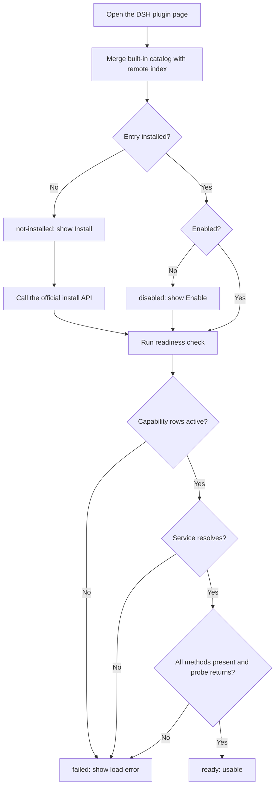

The market has **two sources**: a built-in catalog that ships with the product, and an optional operator-provided remote index. They merge before display, and built-in entries win.

- Built-in catalog: `DSH_CURATED_PLUGINS` (`src/dsh-plugin-catalog.mjs:112`) — works offline, and only first-party entries may declare probe fields.
- Remote index: an HTTPS JSON document, pointed at by `AGENTKIT_STUDIO_DSH_PLUGIN_INDEX` (alias `DSH_PLUGIN_INDEX_URL`).

<Callout type="info" title="The market does not install anything">
  A remote index can only describe *which plugins to offer and how to present them*. Install, enable/disable,
  update, and uninstall are executed by the official DSH plugin manager.
  Source: `src/dsh-plugin-catalog.mjs:5-8`.
</Callout>

<Diagram src="/assets/agentkit-plugin-market.en.png" alt="Plugin market pipeline: the built-in catalog and remote index merge deterministically, pass four readiness layers, and render in the panel, with cache reuse, stale fallback and failure-hint side paths" />

*How to read this: the built-in catalog always wins — the remote index can only append entries or override display fields, and it can neither turn off a built-in `featured` flag nor change the probe fields. None of the three degradation paths leaves the panel empty: a failed refresh keeps the last document marked `stale`, a first failure falls back to the built-in catalog, and a bad entry is counted in `skipped` while the rest continues.*

## Environment variables

| Variable | Alias | Notes |
| --- | --- | --- |
| `AGENTKIT_STUDIO_DSH_PLUGIN_INDEX` | `DSH_PLUGIN_INDEX_URL` (compatibility alias) | Remote index URL, preferred |

When both are set, `AGENTKIT_STUDIO_DSH_PLUGIN_INDEX` wins. An empty value means "built-in catalog only".
Source: `src/dsh-plugin-catalog.mjs:17-18`, `src/dsh-plugin-index.mjs:35-41`.

## Index document shape

```json
{
  "schemaVersion": 1,
  "updatedAt": "2026-11-16T08:00:00.000Z",
  "plugins": [
    {
      "id": "dsh-example-tools", "installSpec": "dsh-example-tools@1.4.2",
      "displayName": "Example Tools", "description": "Example tool set for agents.",
      "category": "效率与通知", "tags": ["tools", "example"],
      "featured": false, "experimental": false, "capabilities": ["example.run"],
      "homepage": "https://example.com", "author": "example", "icon": "◈",
      "repository": "https://github.com/example/dsh-example-tools"
    }
  ]
}
```

`plugins` may also be a bare array. `schemaVersion` is optional, but when present it must equal `1`.
Source: `src/dsh-plugin-catalog.mjs:181-203`.

## Entry fields (complete table)

| Field | Type | Required | Constraint | Default | Source |
| --- | --- | --- | --- | --- | --- |
| `id` | string | ✅ | `PACKAGE_SPEC`, ≤120 chars; accepts `pluginId` / `name` as aliases | — | `:81-82` |
| `installSpec` | string | — | `PACKAGE_SPEC`, ≤140 | `id` | `:83-84` |
| `displayName` | string | — | ≤80 | `id` | `:88` |
| `description` / `category` | string | — | `description` ≤400; `category` ≤24 | `""` / `其他` | `:89-90` |
| `tags` | string[] | — | ≤8 items, ≤24 chars each | Falls back to first 4 `capabilities` | `:91,106` |
| `featured` / `experimental` | boolean | — | Must be strictly `true` | `false` | `:92-93` |
| `capabilities` | string[] | — | ≤12 items, ≤40 chars each | `[]` | `:94` |
| `homepage` / `repository` | string | — | **HTTPS only**, ≤400 | `""` | `:95-96` |
| `author` / `icon` | string | — | `author` ≤60; `icon` is a glyph ≤8 chars with no whitespace or angle brackets, otherwise an HTTPS image | `""` | `:97`, `:58-63` |
| `origin` | string | Automatic | Set by source; always `remote` for remote rows | — | `:99` |

<Callout type="warn" title="Four fields a remote index cannot write">
  `expectedEntries`, `service`, `readinessNote`, and `defaultEnabled` are read **only** from the built-in catalog.
  Remote rows that set them are dropped — this is a trust boundary, not an oversight.
  Source: `src/dsh-plugin-catalog.mjs:10-13,101-107`.
</Callout>

## Document-level constraints

| Constraint | Value | On violation |
| --- | --- | --- |
| `plugins` required | Must be an array | `DSH_PLUGIN_CATALOG_INVALID` |
| Entry limit / `schemaVersion` | 500 / omitted or `1` | `DSH_PLUGIN_CATALOG_TOO_LARGE`, `..._VERSION_UNSUPPORTED` |
| Response size / timeout | 512 KiB / 8 seconds | `DSH_PLUGIN_INDEX_TOO_LARGE`, `..._TIMEOUT` |

Source: `src/dsh-plugin-catalog.mjs:186-191`, `src/dsh-plugin-index.mjs:65-67`.

## URL safety rules

| Rule | Result |
| --- | --- |
| Empty string / `https:` | Built-in catalog only / ✅ Accepted |
| `http:` with host `127.0.0.1` / `localhost` / `::1` | ✅ Accepted (development escape hatch) |
| Any other `http:` or non-HTTP(S) protocol | ❌ `DSH_PLUGIN_INDEX_URL_REJECTED` |
| URL carrying `username` or `password` | ❌ Rejected |

A rejected URL **never empties** the market — the built-in catalog keeps rendering, with a hint in `info.error.code`.
Source: `src/dsh-plugin-index.mjs:43-53,100-109`.

## Cache and degradation

| Behaviour | Rule | Source |
| --- | --- | --- |
| TTL / refresh / headers | 10 minutes; `refresh()` forces a bypass; `accept: application/json`, `user-agent: agentkit-studio-plugin-market` | `:65`, `:146`, `:80` |
| Network failure | Returns the **last successful document**, flagged `stale: true`; with no cache it falls back to the built-in catalog | `:130-141`, `:132` |
| Invalid rows | Counted into `skipped`; the document still loads | `:197,202` |

## Merge semantics

Built-in wins; remote only **refreshes and appends**:

| Case | Result |
| --- | --- |
| Remote id not in the built-in catalog | Appended as a new row with `origin: "remote"` |
| Remote id matches a built-in row | Remote `displayName` / `description` / `tags` / `capabilities` / `homepage` / `repository` / `author` / `icon` / `installSpec` win; `category` only wins when it is not `其他` |
| Boolean / probe fields | `featured` / `experimental` combine with **OR** (remote cannot un-feature a built-in row); `expectedEntries` / `service` / `readinessNote` / `defaultEnabled` keep the built-in value |

Source: `src/dsh-plugin-catalog.mjs:206-232`.

## Curated built-in plugins

`DSH_CURATED_PLUGINS` (`src/dsh-plugin-catalog.mjs:112-158`) contains exactly three first-party rows. All three are **disabled by default** and must be enabled after install.

| Plugin | Name | Category | Capabilities | Default enabled | Readiness (`expectedEntries`) |
| --- | --- | --- | --- | --- | --- |
| `@deepseek-ai/dsh-experimental-agent-team-profile` | Agent Teams | 协作 | `spawn_teammate` / `list_agents` / `team_task` / member conversations | No | `agent-team`, `tool-agent-team`, `ui-agent-team` |
| `@deepseek-ai/dsh-experimental-voice-input-bundle` | 语音输入 | 输入 | Microphone capture / SenseVoice transcription / draft insertion | No | `speech-to-text`, `speech-to-text-sensevoice`, `api-speech-to-text`, `ui-voice-input` |
| `@deepseek-ai/dsh-experimental-auto-review` | Auto Review | 权限 | Tool risk review / Auto permission mode / rejection reasons | No | `auto-review` |

### Service probes and their cost

| Plugin | `service` probe | When to enable | Cost |
| --- | --- | --- | --- |
| Agent Teams | `agentTeams.listMembers` / `spawnTeammate` / `createTask` | Multi-role collaboration with a shared task board | Each member is a session; token use grows with member count |
| 语音输入 | `speechToText.snapshot` (`probe`) / `prepare` / `transcribe` | Chinese voice input and offline transcription | Downloads a local recognition model; needs microphone permission; audio never leaves the machine |
| Auto Review | `permissionPresets.current` / `registerAuto` / `set` | Risk review before tool calls | Every review adds one model call and noticeable latency |

```sh
# Verify each against a real Host (an isolated profile is mandatory)
AGENTKIT_DSH_HOME=/tmp/isolated-dsh \
  pnpm verify-dsh-plugin-market --execute --all
```

After install the state moves `not-installed` → `disabled` → `ready`. On `failed`, read `note` — it names the missing capability rows.
Source: `src/dsh-plugin-catalog.mjs:112-158`, `scripts/verify-dsh-plugin-market.mjs:15-19`.

## Readiness checks

The market assigns each row one state, derived from three layers:

| Layer | What is checked | Passes when |
| --- | --- | --- |
| Capability rows | Each built-in `expectedEntries` value against Host `listPlugins()` row ids | The row id matches exactly, or ends with `#<name>` / `:<name>`, and `fiberPhase === "active"` |
| Service exists | `getService(service.name)` | Returns non-empty |
| Methods / probe returns | `service.methods[]`; `service.probe()` when declared | Every entry is `typeof === "function"`; the probe yields something other than `undefined` / `null` |

| State | Condition |
| --- | --- |
| `not-installed` | `item.installed === false` |
| `disabled` | `item.enabled === false` |
| `failed` / `loaded` | Load error or missing probe / loaded but no `expectedEntries` |
| `ready` | Everything passes |

Source: `src/studio-plugins.mjs:72-115`.

## Install flow

From "I can see a plugin" to "it actually runs" there are four decision points. Failing any one of them stops at that point rather than degrading into "looks installed":



<Callout type="warn" title="Installed is not the same as usable">
Moving from `not-installed` to `ready` requires all three layers to pass. A missing layer stops at `failed` and names whether the capability row, the service or the probe was at fault — it never renders as `ready` and leaves you guessing.
</Callout>

## Evaluating a community plugin

Most plugins in the market have no `expectedEntries`, so their state will only ever be `loaded`. That does not make them unusable — but the judgement is yours to make.

| Check | How to look | Red flag |
| --- | --- | --- |
| Readiness | Does the row declare `expectedEntries`? | No → a failed load will not tell you |
| Service probe | Does it declare `service.methods`? | No → you cannot verify "installed and actually working" |
| Permission surface | Does its `capabilities` claim full access? | Undeclared but expects `danger-full-access` |
| DSH baseline | Does `peerDependencies` pin `0.2.2-rc.1`? | A range that is too wide (`*` / `>=0.1`) |
| Rollback | Is it installed only through the official plugin manager? | Writes profiles or downloads binaries itself |
| Maintenance | npm `keywords` contains `dsh-plugin`; GitHub `topic:dsh-plugin` | Neither |
| Tests | Does the repository have `test/` and CI? | Source only, no tests |

**The cheapest test**: can it pass the same probes as `verify-dsh-plugin-market --execute`? If not, you will be debugging from logs alone.

## Error code reference

| Error code | Trigger | Fix |
| --- | --- | --- |
| `DSH_PLUGIN_INDEX_URL_REJECTED` | URL is neither HTTPS nor localhost | Use HTTPS |
| `DSH_PLUGIN_INDEX_FETCH_FAILED` / `_HTTP_ERROR` | No valid response object, or non-2xx | Check network and gateway; read the status code in `note` |
| `DSH_PLUGIN_INDEX_TOO_LARGE` | Response body > 512 KiB | Split or compress the index |
| `DSH_PLUGIN_INDEX_INVALID_JSON` / `_INVALID` | Body is not JSON, or the structure is invalid | Validate the JSON, then compare against the field table above |
| `DSH_PLUGIN_INDEX_TIMEOUT` / `_UNAVAILABLE` | Exceeded 8 seconds, or unclassified failure | Improve reachability; read `note` |
| `DSH_PLUGIN_CATALOG_INVALID` | Missing `plugins` array | Add the field |
| `DSH_PLUGIN_CATALOG_TOO_LARGE` | More than 500 entries | Split the index |
| `DSH_PLUGIN_CATALOG_VERSION_UNSUPPORTED` | `schemaVersion !== 1` | Set it to `1` or remove it |
| `DSH_PLUGIN_CANCELLED` / `_OPERATION_FAILED` | Operation cancelled, or change did not take effect | Retry; read `details.error.diagnostic` |

## Self-check

```sh
# 1. Document shape + valid entry ids
node -e "const re=/^(?:@[a-z0-9][a-z0-9._-]*\/)?[a-z0-9][a-z0-9._-]*(?:@[A-Za-z0-9.^~<>=*+-]+)?$/;
const d=require('./index.json'); if(!Array.isArray(d.plugins)) throw new Error('plugins must be an array');
for (const p of d.plugins) if(!re.test(p.id)) throw new Error('invalid id: '+p.id);
console.log(d.plugins.length, 'entries ok');"

# 2. Size (must be < 524288)
wc -c index.json
```

Manifest fields are in [DSH plugin authoring](./dsh-plugin-authoring.mdx), negotiation in [host compatibility](./host-compatibility.mdx), npm installs in [npm packages](./npm-packages.mdx), and every error code in the [error reference](../reference/errors.mdx).
