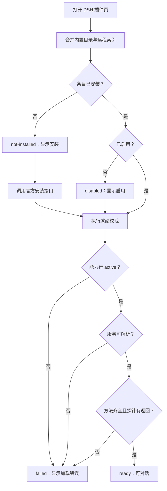

插件市场有**两源**：随产品出厂的内置目录，和运维可选的远程索引。两者合并后展示，内置条目优先。

- 内置目录：`DSH_CURATED_PLUGINS`（`src/dsh-plugin-catalog.mjs:112`），离线可用，只有第一方能声明探针字段。
- 远程索引：一份 HTTPS JSON，指向它的环境变量是 `AGENTKIT_STUDIO_DSH_PLUGIN_INDEX`（别名 `DSH_PLUGIN_INDEX_URL`）。

<Callout type="info" title="市场不负责安装">
  远程索引只能描述「提供哪些插件、怎么展示」。安装、启用/停用、更新、卸载都由官方 DSH 插件管理器执行。
  源码：`src/dsh-plugin-catalog.mjs:5-8`。
</Callout>

<Diagram src="/assets/agentkit-plugin-market.png" alt="插件市场流水线：内置目录与远程索引经确定性合并、四层就绪校验后渲染到面板，并画出缓存复用、stale 降级与失败提示三条旁路" />

*读图要点：内置目录永远赢——远程索引只能追加或覆盖展示字段，不能关掉内置的 `featured`，也改不了探针字段。三条降级路径都不会让面板变空：刷新失败保留上一份并标 `stale`，首次失败回落内置目录，坏条目计入 `skipped` 后继续。*

## 环境变量

| 变量 | 别名 | 说明 |
| --- | --- | --- |
| `AGENTKIT_STUDIO_DSH_PLUGIN_INDEX` | `DSH_PLUGIN_INDEX_URL`（兼容别名） | 远程索引 URL，首选 |

两个都设时，`AGENTKIT_STUDIO_DSH_PLUGIN_INDEX` 优先。空值表示「只用内置目录」。
源码：`src/dsh-plugin-catalog.mjs:17-18`、`src/dsh-plugin-index.mjs:35-41`。

## 索引文档结构

```json
{
  "schemaVersion": 1,
  "updatedAt": "2026-11-16T08:00:00.000Z",
  "plugins": [
    {
      "id": "dsh-example-tools", "installSpec": "dsh-example-tools@1.4.2",
      "displayName": "Example Tools", "description": "为 Agent 提供示例工具集。",
      "category": "效率与通知", "tags": ["工具", "示例"],
      "featured": false, "experimental": false, "capabilities": ["example.run"],
      "homepage": "https://example.com", "author": "example", "icon": "◈",
      "repository": "https://github.com/example/dsh-example-tools"
    }
  ]
}
```

`plugins` 也可以直接是裸数组。`schemaVersion` 可省略，但一旦出现就必须等于 `1`。
源码：`src/dsh-plugin-catalog.mjs:181-203`。

## 条目字段（完整表）

| 字段 | 类型 | 必填 | 约束 | 默认 | 源码 |
| --- | --- | --- | --- | --- | --- |
| `id` | string | ✅ | `PACKAGE_SPEC`，≤120 字符；也接受 `pluginId` / `name` 作为别名 | — | `:81-82` |
| `installSpec` | string | — | `PACKAGE_SPEC`，≤140 | `id` | `:83-84` |
| `displayName` | string | — | ≤80 | `id` | `:88` |
| `description` | string | — | ≤400 | `""` | `:89` |
| `category` | string | — | ≤24 | `其他` | `:90` |
| `tags` | string[] | — | ≤8 项，每项 ≤24 | 回落到 `capabilities` 前 4 项 | `:91,106` |
| `featured` / `experimental` | boolean | — | 必须严格 `true` | `false` | `:92-93` |
| `capabilities` | string[] | — | ≤12 项，每项 ≤40 | `[]` | `:94` |
| `homepage` / `repository` | string | — | **仅 HTTPS**，≤400 | `""` | `:95-96` |
| `author` / `icon` | string | — | `author` ≤60；`icon` 是字形 ≤8 字符且无空白/尖括号，否则必须是 HTTPS 图片 | `""` | `:97`、`:58-63` |
| `origin` | string | 自动 | 由来源决定，远程恒为 `remote` | — | `:99` |

<Callout type="warn" title="四个字段远程索引写不了">
  `expectedEntries`、`service`、`readinessNote`、`defaultEnabled` **只从内置目录读取**。
  远程条目即使写了也会被丢弃——这是信任边界，不是遗漏。
  源码：`src/dsh-plugin-catalog.mjs:10-13,101-107`。
</Callout>

## 文档级约束

| 约束 | 值 | 违反时 |
| --- | --- | --- |
| `plugins` 必填 | 必须是数组 | `DSH_PLUGIN_CATALOG_INVALID` |
| 条目上限 / `schemaVersion` | 500 / 省略或 `1` | `DSH_PLUGIN_CATALOG_TOO_LARGE`、`..._VERSION_UNSUPPORTED` |
| 响应体上限 / 请求超时 | 512 KiB / 8 秒 | `DSH_PLUGIN_INDEX_TOO_LARGE`、`..._TIMEOUT` |

源码：`src/dsh-plugin-catalog.mjs:186-191`、`src/dsh-plugin-index.mjs:65-67`。

## URL 安全规则

| 规则 | 结果 |
| --- | --- |
| 空字符串 / `https:` | 只用内置目录 / ✅ 接受 |
| `http:` 且主机为 `127.0.0.1` / `localhost` / `::1` | ✅ 接受（开发逃生口） |
| 其他 `http:` / 非 HTTP(S) 协议 | ❌ `DSH_PLUGIN_INDEX_URL_REJECTED` |
| 带 `username` 或 `password` 的 URL | ❌ 拒绝 |

被拒绝后市场**不会清空**——继续展示内置目录，并通过 `info.error.code` 给出提示。
源码：`src/dsh-plugin-index.mjs:43-53,100-109`。

## 缓存与降级

| 行为 | 规则 | 源码 |
| --- | --- | --- |
| TTL / 手动刷新 / 请求头 | 10 分钟；`refresh()` 强制绕过；`accept: application/json`、`user-agent: agentkit-studio-plugin-market` | `:65`、`:146`、`:80` |
| 网络失败 | 返回**上一次成功的文档**并标记 `stale: true`；无缓存时回落到内置目录 | `:130-141`、`:132` |
| 无效条目 | 计入 `skipped`，不中断整份文档 | `:197,202` |

## 合并语义

内置优先，远程只做**刷新与追加**：

| 情况 | 结果 |
| --- | --- |
| 远程 id 不在内置里 | 追加为新条目，`origin: "remote"` |
| 远程 id 命中内置 | 用远程的 `displayName` / `description` / `tags` / `capabilities` / `homepage` / `repository` / `author` / `icon` / `installSpec` 覆盖；`category` 只有非 `其他` 时才覆盖 |
| 布尔 / 探针字段 | `featured` / `experimental` 取**或**（内置为 `true` 时远程关不掉）；`expectedEntries` / `service` / `readinessNote` / `defaultEnabled` 保持内置值 |

源码：`src/dsh-plugin-catalog.mjs:206-232`。

## 内置精选插件

`DSH_CURATED_PLUGINS`（`src/dsh-plugin-catalog.mjs:112-158`）只有 3 个第一方条目。三者**默认不启用**，装完要手动开启。

| 插件 | 名称 | 分类 | 能力 | 默认启用 | 就绪校验（`expectedEntries`） |
| --- | --- | --- | --- | --- | --- |
| `@deepseek-ai/dsh-experimental-agent-team-profile` | Agent Teams | 协作 | `spawn_teammate` / `list_agents` / `team_task` / 成员会话 | 否 | `agent-team`、`tool-agent-team`、`ui-agent-team` |
| `@deepseek-ai/dsh-experimental-voice-input-bundle` | 语音输入 | 输入 | 麦克风录音 / SenseVoice 转写 / 草稿插入 | 否 | `speech-to-text`、`speech-to-text-sensevoice`、`api-speech-to-text`、`ui-voice-input` |
| `@deepseek-ai/dsh-experimental-auto-review` | Auto Review | 权限 | 工具风险审查 / Auto 权限模式 / 拒绝原因展示 | 否 | `auto-review` |

### 服务探针与代价

| 插件 | `service` 探针 | 什么时候该启用 | 代价 |
| --- | --- | --- | --- |
| Agent Teams | `agentTeams.listMembers` / `spawnTeammate` / `createTask` | 需要多角色协作与共享任务板 | 每个成员是一个会话，token 消耗随成员数增长 |
| 语音输入 | `speechToText.snapshot`（`probe`）/ `prepare` / `transcribe` | 中文语音输入、离线转写 | 首次需下载本地识别模型；需要麦克风权限；音频不上云 |
| Auto Review | `permissionPresets.current` / `registerAuto` / `set` | 需要工具调用前的风险审查 | 每次审查多一次模型调用，延迟明显增加 |

```sh
# 对真实 Host 逐个验证（必须用隔离 profile）
AGENTKIT_DSH_HOME=/tmp/isolated-dsh \
  pnpm verify-dsh-plugin-market --execute --all
```

装完后状态从 `not-installed` → `disabled` → `ready`。`failed` 时读 `note`，它会点名缺失的能力行。
源码：`src/dsh-plugin-catalog.mjs:112-158`、`scripts/verify-dsh-plugin-market.mjs:15-19`。

## 就绪校验

市场给每个条目一个状态，来自三层检查：

| 层 | 检查什么 | 通过条件 |
| --- | --- | --- |
| 能力行 | 内置条目的 `expectedEntries` 逐项对照 Host `listPlugins()` 的行 id | 行 id 完全相等，或以 `#<name>` / `:<name>` 结尾，且 `fiberPhase === "active"` |
| 服务存在 | `getService(service.name)` | 返回非空 |
| 方法齐全 / 探针有返回 | `service.methods[]`；`service.probe()`（若声明） | 每项 `typeof === "function"`；探针返回值非 `undefined` / `null` |

| 状态 | 条件 |
| --- | --- |
| `not-installed` | `item.installed === false` |
| `disabled` | `item.enabled === false` |
| `failed` / `loaded` | 有加载错误或探针缺失 / 已加载但没有 `expectedEntries` |
| `ready` | 全部通过 |

源码：`src/studio-plugins.mjs:72-115`。

## 安装流程

从「看见一个插件」到「它真的能跑」，中间有四个决策点。任何一步不通过都会停在那一步，而不是降级成「看起来装好了」：



<Callout type="warn" title="安装成功不等于可用">
`not-installed` 变成 `ready` 需要三层检查全部通过。中间任何一层缺失都会停在 `failed`，并带出具体是能力行、服务还是探针不合格——不会显示成 `ready` 让你以为可以用了。
</Callout>

## 如何评估社区插件

市场里绝大多数插件没有 `expectedEntries`——它们的状态只会是 `loaded`。这不代表不可用，但判断得你自己做。

| 检查项 | 怎么查 | 不合格的信号 |
| --- | --- | --- |
| 就绪校验 | 条目有没有 `expectedEntries` | 没有 → 加载失败也不会告诉你 |
| 服务探针 | 有没有 `service.methods` | 没有 → 无法验证「装上了真的能用」 |
| 权限面 | 条目 `capabilities` 是否声明全盘访问 | 未声明却要 `danger-full-access` |
| 跟随 DSH 基线 | `peerDependencies` 是否锁 `0.2.2-rc.1` | 版本范围过宽（`*` / `>=0.1`） |
| 可回滚 | 是否只经官方插件管理器安装 | 自己写 profile、自己下载二进制 |
| 维护活跃度 | npm `keywords` 含 `dsh-plugin`；GitHub `topic:dsh-plugin` | 两者都没有 |
| 有测试 | 仓库是否有 `test/` 与 CI | 只有源码没有测试 |

**最省事的判断**：看它能不能通过 `verify-dsh-plugin-market --execute` 的同一套探针。通不过探针的插件，出问题时你只能靠日志。

## 错误码对照

| 错误码 | 触发 | 处理 |
| --- | --- | --- |
| `DSH_PLUGIN_INDEX_URL_REJECTED` | URL 非 HTTPS 且非 localhost | 换成 HTTPS |
| `DSH_PLUGIN_INDEX_FETCH_FAILED` / `_HTTP_ERROR` | 请求未返回合法响应对象，或非 2xx | 检查网络与网关，看 `note` 里的状态码 |
| `DSH_PLUGIN_INDEX_TOO_LARGE` | 响应体 > 512 KiB | 拆分或压缩索引 |
| `DSH_PLUGIN_INDEX_INVALID_JSON` / `_INVALID` | 响应体不是 JSON，或文档结构不合法 | 校验 JSON，再对照上面的字段表 |
| `DSH_PLUGIN_INDEX_TIMEOUT` / `_UNAVAILABLE` | 超过 8 秒，或未归类的失败 | 提升可达性，读 `note` |
| `DSH_PLUGIN_CATALOG_INVALID` | 缺 `plugins` 数组 | 补字段 |
| `DSH_PLUGIN_CATALOG_TOO_LARGE` | 条目 > 500 | 拆索引 |
| `DSH_PLUGIN_CATALOG_VERSION_UNSUPPORTED` | `schemaVersion !== 1` | 改成 `1` 或删掉 |
| `DSH_PLUGIN_CANCELLED` / `_OPERATION_FAILED` | 操作被取消，或变更未生效 | 重试，读 `details.error.diagnostic` |

## 自检

```sh
# 1. 文档结构 + 条目 id 合法性
node -e "const re=/^(?:@[a-z0-9][a-z0-9._-]*\/)?[a-z0-9][a-z0-9._-]*(?:@[A-Za-z0-9.^~<>=*+-]+)?$/;
const d=require('./index.json'); if(!Array.isArray(d.plugins)) throw new Error('plugins 必须是数组');
for (const p of d.plugins) if(!re.test(p.id)) throw new Error('invalid id: '+p.id);
console.log(d.plugins.length, 'entries ok');"

# 2. 体积（必须 < 524288）
wc -c index.json
```

插件清单字段见 [DSH 插件作者指南](./dsh-plugin-authoring.mdx)，能力协商见 [Host 兼容性](./host-compatibility.mdx)，npm 安装见 [npm 包](./npm-packages.mdx)，全部错误码见[错误码参考](../reference/errors.mdx)。
