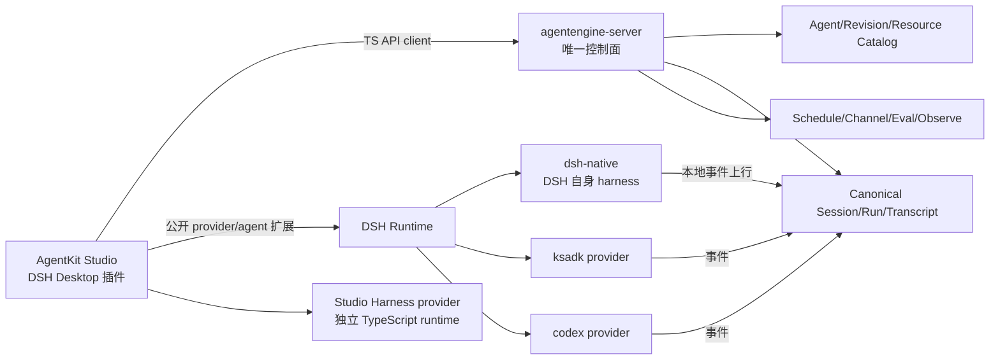
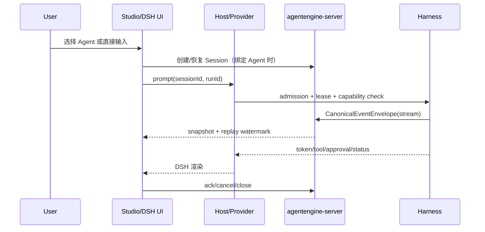
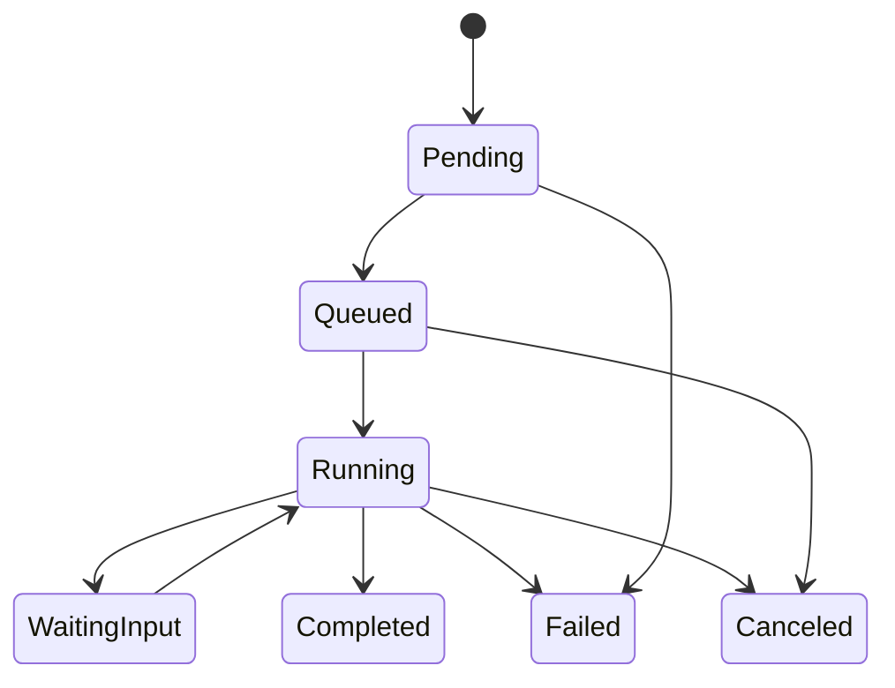
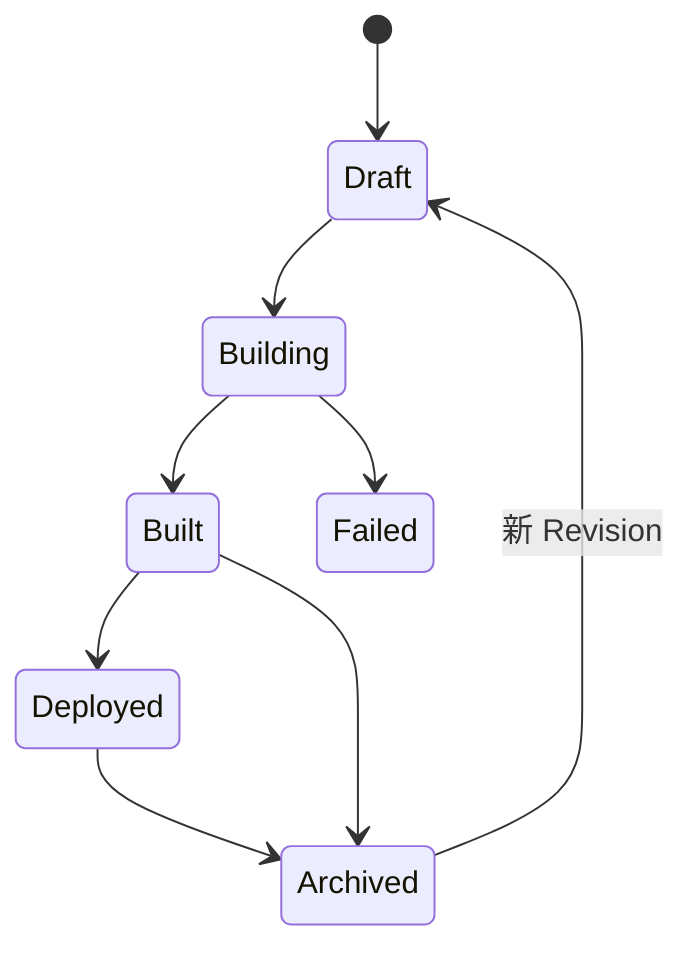
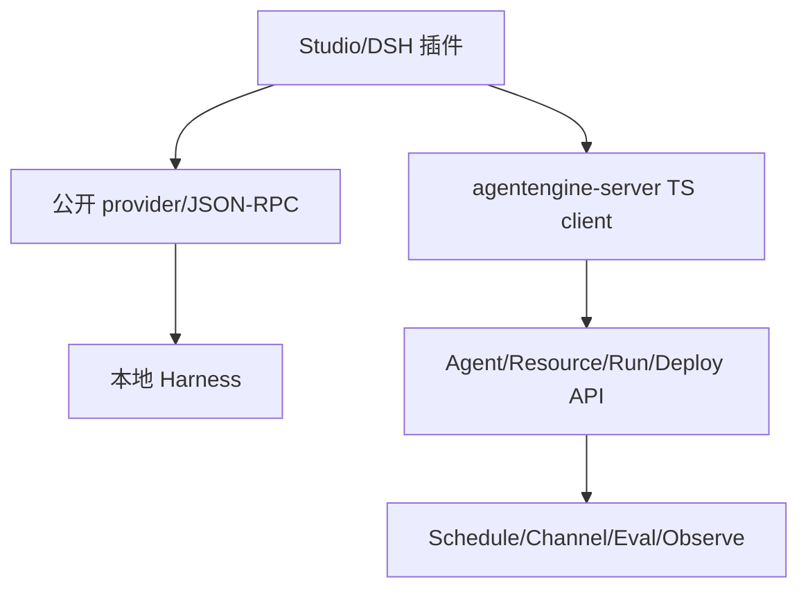

# AgentKit Studio DSH Native 重构方案（RFC 终稿）

> 状态：终稿，作为本轮实现、评审和验收的唯一架构基线。
>
> **2026-09-29 升级**：DSH 基线从 `dsh-v0.1.7-rc.2`（commit `477b4f4…`）升级到 `dsh-v0.2.0-rc.1`（commit `4878cdabd87d4041bdaff61d04c966883b9fd07a`）。本文中 rc.2 相关描述保留为历史对照；`make check`（83/83）与 `make patch-check`（6/6）已在 0.2.0-rc.1 重跑通过，但 rc.2 上记录的资源 Agent admission、preset 准入等 P0 证据尚未在新基线重跑。
>
> **2026-10-01 实现状态更新**：上面的窄准入描述保留为历史基线。本轮 Studio Host 已把本地资源型 `dsh-native`/Harness/Codex Revision 接入 `studio-bridge`，并把来源为 `agentengine-server` 的云端运行时（已验证 `langgraph`）交给 `RunAgent`；两类 Agent 都复用 DSH 原生会话页。云端 Agent 的知识库、记忆库和 Skill Center 绑定已通过 Host 代签 `UpdateAgent` 保存 `ComponentConfig`，但仍需补齐真实资源首轮执行和部署 E2E 证据，不能由本地 MCP 或单个云端运行时样例替代。
> 范围：AgentKit Studio、DSH Desktop、ksadk-python、agentengine-server 的本地与云端协作。  
> 原则：先把真实执行链路和控制面合同钉死，再收口界面和插件市场；任何页面占位都不能代替一条可追踪的执行链。

## 1. 结论

AgentKit Studio 是零代码产品，运行在 DSH Desktop 中，以 DSH 的公开扩展边界连接本地 harness，以 agentengine-server 作为唯一控制面。DSH 原生 harness、ksadk 自研 harness 和 Codex harness 都由同一套 Agent/Revision、Session、Run、CanonicalEvent 和 ResourceRef 合同描述，但各自保留自己的执行语义。

本地无 Agent 的临时对话继续使用 DSH 自身会话；选择了 Studio Agent 的会话必须由 Host 建立 canonical Session、Run 和事件流，即使执行地点是本机，也要把 canonical 事件上行到服务端。这样刷新恢复、取消、审计、评测、观测、定时任务和跨端连续性才有唯一事实源。

所有跨进程集成都只走公开 wire 边界：DSH agent/provider 扩展点，或官方 JSON-RPC SDK 协议；Studio Harness 的进程内执行是 Studio 自己的 TypeScript provider，不依赖 DSH 内核私有对象。向 DSH 内核注入 InputHub、SessionCommandController，或用 sink/bridge 把外部会话硬塞进内核，已实测失败，正式废弃。

当前 UI 已完成产品壳、真实 DSH 无 Agent 对话、运营页面的 Host-backed 接线以及 AgentKit Host 的接线骨架。无资源 `dsh-native` Revision 仍走官方 preset registry；本地资源型 Agent 走 Studio provider bridge，云端 Agent 则走服务端 `RunAgent` bridge。资源目录的完整 CRUD、授权审计、云端知识库/记忆库/Skill 执行，以及云端构建和部署，仍需要按本 RFC 接入真实 server API，不能以页面或 Revision 写入成功验收。

## 2. 问题边界与术语

| 名称 | 定义 | 事实来源 |
| --- | --- | --- |
| Agent | 面向用户的数字员工定义，包含 harness、模型策略、资源引用和能力声明 | agentengine-server AgentCatalog |
| Revision | Agent 的不可变可运行版本，绑定构建产物和资源快照 | AgentCatalog + Build |
| Harness | 执行循环实现。dsh-native 是 DSH 自身 harness；ksadk、codex 通过 DSH provider/agent 扩展接入 | 本地 Provider 或云端 Runtime |
| Resource | 知识库、记忆库、MCP、Skill、模型、Channel、Schedule 等可绑定能力 | ResourceCatalog |
| Session | 对话容器。绑定 Agent 时由 server canonical 管理；无 Agent 时由 DSH session log 管理 | SessionPort |
| Run | Session 中一次可取消、可恢复、可审计的执行 | Run 状态机 |
| Canonical event | 两端交换的规范事件，供 transcript、投影、评测和观测消费 | CanonicalEventEnvelope |

Agent 的模型、MCP、Skill、知识库和记忆库是 Revision 的绑定快照；全局模型密钥、企业凭证和用户偏好属于全局配置，不能偷偷写入 Agent 运行时元数据。资源的引用关系要能被审计、复制和回滚。

## 3. 目标架构



### 3.1 DSH 层：只用公开扩展边界

DSH 层负责 Desktop、会话输入输出、provider/agent 注册、审批 UI 和本地工具生态。Studio 不复制 DSH 的会话 reducer，也不持有另一份 transcript。扩展必须满足以下门禁：

1. 输入和事件必须通过公开 agent/provider 协议；消息格式和版本由 DSH extension contract 固定。
2. DSH 内核的 `InputHub`、`SessionCommandController`、内部 store 和未公开事件不能作为集成点。
3. 需要跨进程执行时使用 newline-delimited JSON-RPC；不得依赖 DSH 私有内存地址、React 状态或 UI DOM。
4. 事件投影只读 canonical store，不能从 DSH session log 反推 Agent Run。

**本地集成教训。** 早期 sink/bridge 路线尝试把外部 Session 硬接进内核对象（`InputHub`、`SessionCommandController`），出现会话 ID 不一致、取消和恢复无落点、刷新后状态丢失等问题。该路线已实测失败并正式废弃，相关内容已从方案中删除；后续代码和文档不得再把它列为备选方案。

**公开 Agent Preset 接缝（无资源路径）。** DSH 的 wire 合同包含
`SessionCreateRequest.agentPreset`，rc.2 的客户端 `sessions.create({ agentPreset })` 已把该字段透传到
官方 Remote；Preset Registry 也提供公开注册点组合 provider、工具和能力。Studio 现在通过
`agents/ensure-preset` 注册一个按 Agent Revision 版本化的 preset，并在官方
`conversation.hero.agentPreset` 槽位调用 `agentPresets.select`。该路径只接受 `dsh-native` 且没有模型、Tool、
MCP、Skill、知识库、记忆库或插件绑定的 Revision；首轮后由 DSH 官方锁定。资源型 Revision 不再伪装成
原生 preset，而是由 Studio provider bridge 承担运行时适配；云端来源的 Agent 则直接由服务端
`RunAgent` 承担执行。真实 rc.2 Web Host selector 冒烟和早期资源型 Revision 的 typed fail-closed 证据分别记录在
`.scratch/studio-dsh-native-2026-09-24/rc2-studio-preset-admission-smoke-2026-09-28.json` 与
`.scratch/studio-dsh-native-2026-09-24/rc2-resource-agent-admission-failclosed-2026-09-28.json`。
这两份文件是历史证据，不覆盖当前 bridge。当前实现已用真实 MCP 工具调用和云端 `langgraph` Agent
完成浏览器验证；动态 AgentRevision/ResourceBinding 的完整映射、事件、资源授权、取消和恢复仍需公开
provider/server 合同，不能通过 DOM、React 状态、`session.append` 或私有 sink 补齐缺口。

### 3.2 Studio 产品层

Studio 负责四个产品域：

| 产品域 | 真实职责 | 页面形态 |
| --- | --- | --- |
| Agents | Agent 生命周期、Revision、运行目标和本地调试 | 独立创建页、编辑页、Agent 详情页 |
| 资源库 | 模型、知识库、记忆库、MCP、Skill、本地 Skill、市场安装 | 资源列表、详情、版本和授权页 |
| 运行中心 | Run、评测、观测、Channel、Schedule、构建和部署 | 二级导航，所有动作有 server/Host API |
| 会话 | 无 Agent 的 DSH 对话或绑定 Agent 的 canonical 对话 | DSH 原生会话页投影 |

快速创建和一键创建是独立创建页的两种入口；复杂编排、资源绑定、从对话生成 Agent 或 Schedule 可以在对话页通过自然语言触发，但最终仍必须落 Agent/Revision/ResourceBinding/Build/Deployment 记录。任何“创建成功”提示都必须能回查这些记录。

### 3.3 统一 SessionPort（合并原 KsADKSessionPort 与 SessionPort）

SessionPort 是 Studio、DSH adapter 和 server 之间唯一的会话合同，不再维护两套同义接口。它同时描述 Host→DSH 的输入方向和 DSH→Host 的命令方向：

```typescript
interface SessionPort {
  createSession(input: CreateSessionInput): Promise<SessionSnapshot>;
  listSessions(input: ListSessionsInput): Promise<Page<SessionSnapshot>>;
  getSession(sessionId: string): Promise<SessionSnapshot>;
  closeSession(sessionId: string, reason?: string): Promise<void>;
  prompt(input: PromptInput): AsyncIterable<CanonicalEventEnvelope>;
  cancelRun(input: CancelRunInput): Promise<void>;
  pauseRun(input: PauseRunInput): Promise<void>;
  resumeRun(input: ResumeRunInput): Promise<void>;
  sendCommand(input: HostToDshCommand): Promise<void>;
  onCommand(handler: (command: DshToHostCommand) => Promise<CommandResult>): Unsubscribe;
}
```

`listSessions` 和 `closeSession` 是恢复、退出和审计所需的硬合同。DSH 原生无 Agent 会话可以只实现 DSH session log 的局部适配，但绑定 Agent 的会话必须能映射到 server canonical Session。`prompt`/`cancelRun`/`pauseRun`/`resumeRun`/`sendCommand` 走 DSH→Host 命令方向，Host 是命令的唯一落点；其中 `pauseRun`/`resumeRun` 不代表挂起，按 §4.2 固定为 cancel + 重发语义。

### 3.4 本地执行路线与多 Harness

- **dsh-native**：直接使用 DSH 自身 harness、模型选择和工具生态。Studio 不另造一个“DSH harness”插件，也不模拟 DSH 的回显。
- **ksadk / codex**：需要接入 DSH 时以公开 agent/provider 扩展注册执行循环；`subagent-codex` 仅作 provider 参考实现，目前 one-shot，持久 thread、恢复、取消是最大技术风险，时间盒 1–2 周验证。
- **Studio Harness**：位于本仓库 `src/providers/agentkit-harness.mjs` 的独立 TypeScript/Node provider，不导入 KsADK/Python，不注入 DSH InputHub 或 SessionCommandController。首个切片提供本地 Session、文本流、per-session canonical envelope、幂等回放、取消和 cancel+resend 恢复；MCP、Skill、知识库和记忆适配器在同一 ProviderPort 上逐步接入。它可以直接由 Studio Node Host 或端侧 endpoint 启动，也可以由 server worker 托管。
- **兄弟关系**：ksadk 与 agentkit-studio 是平等客户端，各自直连 agentengine-server；Studio Harness 不以 KsADK 为库依赖。只有明确选择 KsADK 托管运行时、且需要驱动 DSH 工具生态时，才使用公开 wire/JSON-RPC 集成。
- **官方 Python SDK**：PyPI 包名 `deepseek-harness-sdk`，由 Python 侧启动 `dsh --profile sdk` 子进程，通过 newline-delimited JSON-RPC over stdio 驱动；SDK 支持按 `sessionId` 排队 prompt、流式事件和服务端入站请求。KsADK 托管运行时需要驱动 DSH 工具生态时可使用它。它是公开协议集成，不是向 DSH 内核注入私有桥。
- **macOS App**：不打包 Python，不内置私有 runtime。ksadk-harness 本地执行仅存在于开发 / CI / 独立 CLI；产品内高代码 agent 一律云端执行（Step 5 端侧端点自带运行时是后话）。需要本地 Python 执行时由用户或开发环境提供独立运行时，桌面插件仍只调用公开 provider/JSON-RPC。

`deepseek-harness-sdk` 的 pre-release 版本（当前 `0.0.0.dev0`）与 DSH `0.1.7-rc.2` 不同，部署时必须锁定 SDK 和 `deepseek-harness-runtime-bin` wheel 的兼容版本，并在启动握手中传递 provider、model、reasoning effort 和 max tokens。SDK 是需要驱动 DSH 工具生态的托管运行时手段，不是 AgentKit Studio 本地产品的必选依赖。

### 3.5 核心闭环



## 4. 合同与状态机

### 4.1 Agent、Revision 与 HarnessRuntimeKind

`HarnessRuntimeKind` 是 Agent/Revision 的属性，不属于 `AgentCatalogPort` 的请求级参数。Catalog port 只声明服务端或客户端支持的集合：

```typescript
type HarnessRuntimeKind = "dsh-native" | "ksadk" | "codex" | "custom";

interface AgentRevision {
  agentId: string;
  revisionId: string;
  harnessRuntimeKind: HarnessRuntimeKind;
  modelRefs: string[];
  resourceRefs: ResourceRef[];
  capabilities: Capability[];
  buildId?: string;
  status: "draft" | "built" | "deployed" | "archived";
}

interface AgentCatalogPort {
  supportedHarnesses(): Promise<HarnessRuntimeKind[]>;
  createAgent(input: CreateAgentInput): Promise<AgentSnapshot>;
  updateRevision(input: UpdateRevisionInput): Promise<AgentRevision>;
  getAgent(agentId: string): Promise<AgentSnapshot>;
}
```

Revision 在 `buildId` 生成时**固化冻结**：harness、模型策略、资源快照和 capability 均不可变。`deploy` 只接受 `buildId`，部署一律以 Revision 冻结值为准，Deployment 只引用 Build 产物（§4.3）；`AgentCatalogPort` 只声明 `supportedHarnesses` 支持集合，不接受请求级 harness 指定。

### 4.2 Run 状态机

Run 状态机**不设 `Paused`**。“暂停”的用户语义固定为 **cancel + 重发**：取消当前 Run，再以同一 Session 上下文重发后续输入；该语义必须显式执行、对用户可见、可审计，UI 不得把执行器仍在运行伪装成挂起，客户端也不得不加提示地静默 cancel+resend。根因是当前执行器是 one-shot（典型如 `subagent-codex` provider），不支持挂起/恢复。真 `Paused` 状态留作**合同演进项**：待执行器支持持久 thread 与挂起后经合同版本化引入；在此之前 harness 在 capability 中声明不支持原生挂起，`pauseRun`/`resumeRun` 命令按 cancel + 重发语义实现。



### 4.3 Build 与 Deployment

Build 是可复现的构建产物；Deployment 只引用 Build，不接受未构建的 Agent 草稿：

```typescript
interface BuildPort {
  createBuild(revisionId: string): Promise<BuildSnapshot>;
  getBuild(buildId: string): Promise<BuildSnapshot>;
}

interface DeploymentPort {
  deploy(input: { buildId: string; target: DeploymentTarget; idempotencyKey: string }): Promise<DeploymentSnapshot>;
  rollback(deploymentId: string, toBuildId: string): Promise<DeploymentSnapshot>;
  getDeployment(deploymentId: string): Promise<DeploymentSnapshot>;
}
```

### 4.4 Typed error

所有端和云端共享一张错误表，错误必须可分类、可重试、可审计。清单统一为 code / message / source / scope 四要素（另附 retryable）：

| code | message（固定语义） | source | scope | retryable |
| --- | --- | --- | --- | --- |
| `invalid_argument` | 请求字段或资源引用不合法 | 合同校验（client/server） | 单次调用 | 否 |
| `unauthenticated` | 凭证缺失或已过期 | server 鉴权 | 会话级 | 否 |
| `permission_denied` | 没有资源或能力权限 | server 授权 / endpoint grant | 资源或能力级 | 否 |
| `not_found` | Agent、Session、Run 或 Resource 不存在 | server store | 单次调用 | 否 |
| `conflict` | 版本、lease 或幂等键冲突 | server store | 资源或命令级 | 条件 |
| `capability_unsupported` | 当前 harness 不支持该动作 | provider / harness | harness 级 | 否 |
| `pause_unsupported` | 执行器不支持原生挂起（one-shot；保留给合同演进的真 Paused） | provider / harness | harness 级 | 否 |
| `rate_limited` | 配额或速率限制（429） | model-proxy / server | run 级 | 是 |
| `upstream_unavailable` | 上游模型、DSH 或端点暂不可用 | transport | run 级 | 是 |
| `timeout` | 操作超时 | transport / 执行器 | 调用或 run 级 | 是 |
| `approval_required` | 等待用户或策略审批 | Host / 审批 | interaction 级 | 否 |
| `sequence_gap` | 事件序号缺口，需补拉/重同步 | envelope `sequence` | session 级 | 是（补拉） |
| `internal` | 未分类内部错误，必须带 traceId | 任意 | 任意 | 条件 |

`error_category=unknown` 不得毒化子代理重试回落；未知错误先映射为 `internal` 并保留原始 provider code。

## 5. CanonicalEventEnvelope 草案

两端事件只使用以下 12 个字段；字段增加必须走合同版本化：

```json
{
  "sessionId": "ses_...",
  "runId": "run_...",
  "eventId": "evt_...",
  "sequence": 42,
  "watermark": "wm_...",
  "idempotencyKey": "idem_...",
  "snapshotReplay": "snapshot|live|replay|boundary",
  "interactionId": "int_...",
  "errorInfo": null,
  "executionLocus": "cloud|endpoint-id",
  "timestamp": "2026-09-24T00:00:00Z",
  "kind": { "type": "assistant.delta", "data": { "text": "增量" } }
}
```

- `kind` 是带 `type` 和 provider payload 的标记对象；payload 不再新增顶层字段，保持 Envelope 顶层 12 字段。
- `runId` 标识事件所属 Run，是事件的属性而非排序依据。
- `sequence` 为 **per-session** 序号，作用域写死为单个 Session 内单调递增、**跨 Run 连续**；它服务于跨 run 恢复与 snapshot-replay 边界判定。不同 Session 的序号互不相干，同一 Session 的不同 Run 不重置序号。
- `watermark` 标记消费端已确认的事件边界；`snapshotReplay` 区分快照、实时、补放和边界事件。
- `idempotencyKey` 覆盖用户 prompt、工具调用和控制命令；重复事件必须可安全丢弃。
- `executionLocus` 取 `cloud` 或具体 `endpoint-id`，用于端云协作和审计。
- `errorInfo` 为空时必须显式为 `null`，错误时只放 typed error 的结构化信息，不把堆栈写进 UI 合同。

Python 产事件侧和 TypeScript 投影侧共用 golden fixtures。conformance 测试必须验证字段、序号、watermark、边界、幂等和错误映射；conversation-contract 使用独立共享包，或由 Python schema 生成 TS 类型，禁止维护两份 reducer。

## 6. Agent 与资源生命周期

### 6.1 Agent 生命周期



创建、编辑、复制、构建、部署、回滚、归档都要写 server 记录；本地调试可以使用 endpoint-local deployment，但仍引用同一个 `buildId` 和 Revision。创建页仅收集最小字段，资源编排和自然语言生成落在 Agent 详情/对话页，不能生成一个只存在于前端 state 的 Agent。

### 6.2 资源类型和绑定规则

| 资源 | 生命周期 owner | 绑定位置 | 是否可全局复用 |
| --- | --- | --- | --- |
| 模型/凭证 | server CredentialStore 或本地安全存储 | Agent Revision / Workspace 默认 | 凭证可复用，模型引用需授权 |
| 知识库 | ResourceCatalog | Revision 快照 | 可跨 Agent 引用 |
| 记忆库 | ResourceCatalog | Agent 或 Session 策略 | 可跨 Agent，但会话写入按 Agent 隔离 |
| MCP | ResourceCatalog + capability grant | Revision | 只读授权后复用 |
| Skill Center Skill | Marketplace/ResourceCatalog | Revision | 版本化安装 |
| 本地 Skill | DSH profile/endpoint | 本地 Revision | 不自动上传，需显式打包 |
| Schedule | server ScheduleStore | Agent/Revision | 不属于 DSH 临时会话 |
| Channel | server ChannelStore | Agent/Revision | 逐 Channel 授权 |

资源绑定页、版本、安装、授权、撤销和删除都必须有真实 API。当前工程里已保留资源域入口和 Host 连接错误态，但上述 ResourceCatalog/ScheduleStore/ChannelStore 的完整 CRUD、审计和云部署尚未完成，不能宣称“已经做成 DSH 插件”。

### 6.3 会话归属规则

| 对话类型 | 归属 | 恢复方式 | 评测/观测 |
| --- | --- | --- | --- |
| 无 Agent 的临时对话 | DSH session log | DSH 原生恢复 | DSH 本地能力，按需导出 |
| 绑定数字员工的对话 | server canonical transcript（云中心、跨端连续） | watermark + snapshot replay | server/OTel 全量 |
| 本地执行的绑定 Agent 对话 | server canonical transcript，事件 locus 为 endpoint-id | 本地 lease + 上行事件 | 与云端同一 Run |

## 7. 端云协同

端云协同排在核心闭环之后实现，四块能力不能互相替代：

1. **会话与身份云中心**：Session、Run、Transcript、用户身份、组织策略和跨端 watermark 由 server 管理。
2. **端侧执行端点**：端点配对、逐能力授权、DSH `ui-approval` 审批、lease、审计和吊销；端点永远不能凭默认登录态获得全部 MCP/Skill 权限。
3. **任务交接**：云端 Run 可交给在线 endpoint，endpoint 断开时按 lease 和 checkpoint 交还云端或等待用户选择；交接全程以 CanonicalEventEnvelope 的 `executionLocus`（`cloud | endpoint-id`）标记执行位置。
4. **离线降级**：无网络时只允许已授权能力的本地执行；事件本地落盘并带 sequence/watermark，恢复后补放，不能伪装成云端已提交。

### 7.1 独立威胁模型

默认拒绝、逐能力授权、敏感操作审批和全程审计是不可谈判的底线。Threat model 至少覆盖：失效或被盗的 endpoint token、重放事件、过期 lease、恶意 MCP、跨 Agent 记忆泄露、离线队列篡改和 Channel 凭证泄露。所有拒绝和吊销都产生 canonical audit event。

## 8. 可复用能力与插件边界

### 8.1 可以直接复用

- DSH Desktop 的 workspace、会话列表、文件与命令工具、审批 UI、session log 和 provider 注册机制。
- DSH 的公开 JSON-RPC SDK 协议和 `deepseek-harness-sdk` subprocess 运行方式。
- `ksadk-web` 作为调试页/hosted UI 的静态构建产物，由 `ksadk web` 或 `ksadk dashboard` 提供服务。
- agentengine-server 现有 Agent、Build、Deployment、Schedule、Channel、Transcript API，按 §15.6 只做向后兼容的加法字段。

### 8.2 不能直接复用

- 旧 Studio 的 React UI、DSH 私有 reducer、DeepSeek 默认品牌和内测声明。
- 已废弃的 sink/bridge 路线（见 §3.1 教训）：实测失败，不属于可复用对象，也不是备选方案。
- 只有 one-shot 语义的 Codex provider，除非补齐持久 thread、恢复、取消和审批能力。

### 8.3 插件市场

插件市场分为 DSH 插件广场和 Codex/AgentKit 扩展市场两个来源，安装结果统一为带来源、版本、权限和兼容性声明的 Resource/Provider。市场只负责发现、安装和升级，不绕过 Agent Revision 的授权流程；旧 Studio 的知识库、记忆库和 Skill 中心如果只依赖旧私有 API，应先做合同适配再迁移。

## 9. 分阶段迁移

现行执行词汇只有 Step 0–5。旧方案 §7 的 P0–P7 只作历史对照，任何 P 阶段引用都按下表换算；两套词汇不并行维护，出现歧义时以 Step 为准。

### Step ↔ 旧 §7 P0–P7 映射（历史词汇对照）

| Step（现行） | 旧 §7 P 阶段（历史词汇） | 换算说明 |
| --- | --- | --- |
| Step 0 文档 | （新增，位于 P0 之前） | 本 RFC、golden fixtures、错误表和资源绑定矩阵 |
| Step 1 Provider 换轨 | P0 官方宿主 Spike + P2 的执行侧前置 | 时间盒 1–2 周，含到期决策点 |
| Step 2 合同钉死 | P1 合同、映射与 API 差距 | server API 映射表 + Envelope + 双侧 conformance |
| Step 3 ksadk 削减 | P6 的仓库清理部分 | 前置：Studio 已切直连 server + provider 并完成回滚验证 |
| Step 4 产品收口 | P2 本地垂直切片 + P3 macOS + P4 云端 + P5 插件 + P6 切换 | 产品闭环与验收收口 |
| Step 5 端云协同 | 无对应（新增范围，见 §7） | 端点配对/授权/任务交接/离线 |
| 不进入 Step 主线 | P7 历史云端 Agent 兼容插件 | 保持可选后续，不阻塞任何 Step |

### Step 0：文档和合同基线

完成本 RFC、golden fixtures、错误表和资源绑定矩阵，删除与新分工冲突的历史前提。

### Step 1：Provider 换轨（时间盒 1–2 周）

用 DSH 公开 agent/provider 扩展验证 dsh-native、ksadk 和 Codex 三条执行路；不得再投入 InputHub/SessionCommandController bridge。subagent-codex 的 one-shot 限制（缺持久 thread/恢复/取消）是本步最大技术风险。**到期决策点**：持久 thread、恢复、取消、审批和事件上行全部达标才进入默认 provider；否则在“接受云-only 低代码执行”与“改走 wire 协议路线”之间拍板，不做无限期延期。

### Step 2：合同钉死

形成 agentengine-server API 映射表、CanonicalEventEnvelope、Python 产事件和 TS 投影双侧 conformance、SessionPort 和 typed error 兼容矩阵。

### Step 3：ksadk 削减

Studio 切换为直连 server + DSH provider 后，按 §11.2 删除旧 Studio UI 和命令，保留调试服务命令；对跨域模块单独审查。

### Step 4：产品收口

完成 Agent 独立创建/编辑页、资源生命周期、快速创建/一键创建、Agent 详情对话、真实 Run 流式回显、评测、观测、Channel、Schedule 和云部署。

### Step 5：端云协同

完成端点配对、逐能力授权、审批、lease、任务交接、离线补放、审计和吊销。

## 10. 不能用来验收的结果

以下结果都不能证明链路完成：

1. 页面显示“创建成功”，但 server 查不到 Agent/Revision/Build。
2. 对话能回显文字，但 `listSessions` 查不到绑定 Agent 的 canonical Session。
3. 能看到 token 流，但事件没有 `runId`、sequence、watermark 或幂等键。
4. 绑定了 MCP/Skill/知识库的卡片能展示数量，但 Run 没有实际加载和审计对应 ResourceRef。
5. 刷新后 DSH session log 还在，却没有 server transcript、Run 状态和 replay watermark。
6. 点暂停后 UI 变灰、实际执行器继续运行，或不加提示地静默 cancel+resend：暂停必须按 §4.2 的 cancel + 重发语义显式执行、对用户可见并可审计。
7. 使用默认 DeepSeek 模型、内测声明或 DSH logo 的页面截图，不能证明 AgentKit Studio 品牌和模型配置已接通。
8. mock 的云部署按钮、静态评测数字、假 Channel/定时任务列表不能作为验收证据。

## 11. 仓库分工与发行

### 11.1 终态分工

| 组件 | 终态职责 | 明确不负责 |
| --- | --- | --- |
| `ksadk-python` | 高代码 SDK、CLI、评测/评测集、调度、观测、云上托管运行时；`ksadk web` / `ksadk dashboard` 保留：serve ksadk-web 构建产物作调试页/打开 hosted UI，类比 `adk web` | 零 UI，不持有 UI 源码 |
| `agentkit-studio` | 零代码产品全权：DSH Desktop 插件、本地 provider、直连 agentengine-server 的 TS client | 不依赖 ksadk 产品面/内部 API（运行时集成例外见 §3.4），不复制 server 控制面 |
| `agentengine-server` | 控制面不变：Agent/Revision/Resource/Build/Deployment、canonical Session/Run、Schedule/Channel、审计和 OTel 控制面 | 不提供数字员工产品模板或工作台 UI |
| `ksadk-web` | Hosted UI 静态构建产物与共享合同资产（由 `ksadk web`/`ksadk dashboard` 或 Hosted UI 服务提供） | 不成为 AgentKit Studio 的运行时依赖 |

ksadk 与 agentkit-studio 是兄弟客户端，平等调用同一套 agentengine-server API；“互不调用”限定为产品面/内部 API——运行时集成不受此限，ksadk harness 经 DSH provider 扩展 + wire 协议（subprocess jsonrpc）作为外部执行器接入（§3.4）。macOS App 不打包 Python，因此旧文档中“本地 Python Host”“private runtime 随 App 发布”的 §11.2/§11.3 内容删除，不再作为实现方案。

资源边界（写死，不允许随实现漂移）：

- macOS 打包 app 不含 Python；
- ksadk-harness 本地执行仅存在于开发 / CI / 独立 CLI；
- 产品内高代码 agent 一律云端执行（Step 5 端侧端点自带运行时是后话）；
- provider 扩展点留给 codex（Node/二进制）与未来端点。

### 11.2 ksadk 削减清单

切换完成后删除：

- `ksadk/studio/**`：99 个 Python 文件及约 741MB 的 `react-ui` 构建产物；
- `cmd_studio` 及其只服务旧 Studio 的启动、打包和品牌资源。

保留：

- `cmd_web`：继续服务 ksadk-web 调试构建，方便 SDK 开发和 hosted UI 调试；
- `cmd_dashboard`：保留运维/观测入口，避免把调试能力误认为 Studio 产品。

`a2a`、`a2ui`、`agui`、`openclaw`、`scheduler` 等跨域模块另开审查轮次；不得在删除 Studio 的同一提交里顺手删掉。执行顺序固定为：Studio 切换到直连 server + provider → 完成回滚验证 → 再删除旧目录和命令。

### 11.3 发行和配置

DSH profile 只保存本地扩展、模型提供商配置和 endpoint 配对信息；全局 `~/.agentkit` 可保存用户同意的通用配置和本地 Agent 调试元数据，但凭证必须走系统安全存储或 server CredentialStore。Studio 版本、DSH 版本和 provider 版本分别展示，不能再把 DSH 版本冒充 Studio 版本。

## 12. DSH Desktop 基线与历史迁移说明

按 2026-09-27 用户决定，当前验收基线固定为官方最新 RC `dsh-v0.1.7-rc.2`（commit `477b4f420553e8a52c2fbccc464d7561b239c443`）。`rc.1` 只保留为历史证据；任何只在 rc.1 上通过的门禁都必须在 rc.2 重跑后才能标绿。Studio 只替换可扩展品牌和产品层，不改变 DSH workspace、会话和文件工具的基本语义。

去掉本地 KsADK/Python 依赖不等于去掉 `agentengine-server`。Studio 的 Node Host 通过公开 AgentEngine Action API 直接调用 server：凭证只在 Node Host / `~/.agentkit/config.yaml`，浏览器仅通过 DSH Connection RPC 获取脱敏结果。当前迁移先覆盖 Agent catalog、详情和平台资源目录；创建、Revision、Session/Run、Schedule、Build/Deployment 等动作按 server API gap 逐步替换旧本地 Host 路由，在全部迁移完成前不得声称 KsADK 已从产品链路移除。

历史上“Client Embed vs Core Host”的比较表和 worktree 清单只用于解释失败尝试，不能作为现行架构。现行方案不要求 Client Embed 注入 DSH Core Host，亦不要求 AgentKit Studio 启动另一个隐藏 DSH UI。

## 13. 当前执行状态

### 13.1 已完成

- salvage 已完成：`3cae2806`（events: codex→canonical 映射）、`53869ff0`（model-proxy 限流预算）、`17f620b1`（kernel admission/幂等/durable turn.cancel）、`274cf46b`（harness 重试预算，含一处真实回归修复：`error_category=unknown` 毒化子代理重试回落）已入本地 master，经 `salvage/764a-runtime-assets` 分支走代码评审 #130 合入。
- `764a` 与 `ksadk-web-studio` worktree 已归档；ksadk-web 的 resumable session transport 与 core/conversation 资产已存 `.scratch`，供共享合同复用。
- 散落 worktree 已清扫；合并留痕按 MANIFEST 处理，不保留并行旧壳。
- DSH 官方 Python SDK、事件映射、canonical probe、Host runtime adapter 和 Studio 应用页面的基础测试已通过。
- Studio UI 已改为 AgentKit Studio 品牌和四个一级域；无 Agent 的 DSH 原生对话和 Host 连接错误态是真实路径。
- 2026-10-01 验证刷新：本地 MCP 资源在 DSH 原生会话中完成真实工具调用；云端 `langgraph` Agent 在同一
  原生会话中完成 `RunAgent` 执行并返回固定探针文本。Studio `pnpm check` 与 Agent admission focused suite
  均通过；Python focused suite 312 passed/8 skipped，
  `make ci` 打包通过；当前 rc.2 packed artifact 与 browser profile 均能启动，独立 fixture 与 SDK transcript
  的 node-store probe 仍保留为历史/协议证据；直连 AgentEngine 的目录、详情和平台资源读取已由 Studio Node
  Host 接管。无资源 `dsh-native` Agent 的官方 preset 窄准入、本地资源 bridge 和云端 Runtime bridge 已接入；
  云端资源激活、完整资源合同和内存门禁仍未签收。

### 13.2 未完成且不能标绿

| 工作 | 当前状态 | 完成证据 |
| --- | --- | --- |
| Agent 创建/编辑/Revision | 有基础页，server 全量合同未接完 | server Agent/Revision/Build 查询与回归测试 |
| 知识库/记忆库/MCP/Skill 生命周期 | 目录读取和云端 Agent ComponentConfig 绑定保存已接入；完整 CRUD、授权、审计及资源首轮执行未完 | ResourceCatalog golden + UpdateAgent 保存回读 + 真实 API E2E |
| 云构建与部署 | UI 不再伪造成功，待接 DeploymentPort(buildId) | 构建、部署、回滚和幂等证据 |
| 绑定 Agent 的流式会话 | 无资源 `dsh-native` 走官方 preset registry；本地资源型 Agent 走 Studio bridge；云端 Agent 走 `RunAgent` bridge，均复用 DSH 原生会话页 | 已验证无资源 selector/lock、本地 MCP 工具调用和云端 `langgraph` RunAgent；云端知识库/记忆库/Skill 及取消恢复仍需 server transcript + DSH UI E2E |
| 评测、观测、Channel、Schedule | 归位已确定，端到端接线未完 | 一次 occurrence 单 owner 的 E2E |
| 端云协同 | 未开始 | 配对、授权、lease、离线补放与审计 |

## 14. CI、服务和版本关系

Python 产事件、TypeScript 投影和 server 合同在 CI 中分别测试并用 golden fixtures 互验。每个 provider 必须运行真实 DSH profile；仅构造 JSON 或静态页面的测试只能覆盖序列化，不得宣称执行链通过。

版本至少拆成：DSH runtime version、Studio plugin version、provider version、server contract version。合同只做向后兼容的加法，破坏性修改需要新版本和迁移器。

## 15. 评测、观测、Channel、自动化和云端管理

### 15.1 插件分层

插件只提供能力和 UI 入口，资源绑定、授权、Run 和审计仍由 server/Host 合同负责：



### 15.2 DSH 能力复用

DSH workspace、session log、文件、命令、审批、provider 注册和模型流式渲染直接复用；Studio Harness 自己实现 SessionStore、事件流和模型适配；品牌、Agent 生命周期、资源中心、评测观测面板、Channel/Schedule 产品逻辑由 Studio 自己实现。

### 15.3 评测与观测归位

| 能力 | 本地 owner | 云端 owner |
| --- | --- | --- |
| 评测/评测集 | `ksadk eval`、`ksadk evalset` | server 任务编排和结果存储 |
| 自动化调度 | `ksadk scheduler`、桌面常驻 scheduler | server ScheduleStore/worker |
| 观测 | `ksadk observe`、本地 session log | OTel collector/查询 |
| Run/Transcript | endpoint-local cache + 上行 | server canonical store |

一次 occurrence 只有一个 owner。调度任务切到云端后，本地 scheduler 必须记录 transfer/disabled 状态，不能两个 worker 同时执行同一 occurrence。评测和自动化不是“可能云 only”；本地 owner 和云端 owner 按部署形态明确分工。

### 15.4 Channel

Channel 绑定 Agent/Revision 和授权凭证，由 server ChannelStore 管理；本地 endpoint 只处理被授权的端侧事件。发送、重试、去重、撤销和审计都引用 Run/interactionId，不能把 Channel 当作一条隐藏 DSH 会话。

### 15.5 Schedule

Schedule 绑定 Agent/Revision、输入模板、资源权限和 Channel。自然语言创建 Schedule 必须先生成可审阅的结构化草案，再由用户确认后写入 ScheduleStore；执行 occurrence 仍遵守“一次 occurrence 一个 owner”。

### 15.6 云端 Agent 创建、编辑和平台合同

agentengine-server 现有 API 是唯一控制面合同；`ksadk-python` 与 `agentkit-studio` 是两个平等客户端。兼容升级只做加法字段：`kind`、`origin`、`runtimeRef`、`resourceRefs`、`capabilities`、`deploymentRef`、幂等键和 typed error。两端不得各自发明一套 CreateSession/RunAgent 私有协议。

数字员工平台只提供底层能力：API、SDK、运行时、canonical transcript、Schedule/Channel 绑定和端侧 endpoint；不提供数字员工产品、模板或工作台，那些属于 AgentKit Studio。平台硬化是第一优先级：service account/API key、配额、审计、合同版本化，以及向外部 Python/TS 客户端开放 conformance 测试。**硬化项随 Step 2 的 server 变更一并落地，不另开阶段。**

### 15.7 agentengine-images

镜像只承载可复现的 provider/runtime 和构建产物，不把 Studio UI 或用户凭证烘焙进去。镜像版本必须可映射到 Build、Deployment 和 provider 版本。

## 16. 可执行计划与 Review 门禁

### 16.1 阶段产物

| Step | 产物 | 决策门 |
| --- | --- | --- |
| 0 | 本 RFC、API 映射、golden fixtures、资源矩阵 | 文档内部无矛盾 |
| 1 | 三类 provider 的真实 DSH profile 验证 | 1–2 周时间盒；到期决策点拍板：接受云-only 低代码执行或改走 wire |
| 2 | SessionPort、Envelope、typed error 双侧 conformance | Python/TS/server 一致 |
| 3 | ksadk 削减提交和回滚方案 | 旧 Studio 已不在生产链 |
| 4 | Agent/Resource/Run/Deploy/评测/观测/Channel/Schedule 产品闭环 | 无 mock 验收项 |
| 5 | 端云协同和威胁模型门禁 | 默认拒绝、授权、审批、审计通过 |

### 16.2 性能和稳定性

- 事件批处理最多 1 帧；单批上限 32 个事件或 64KiB，先达到任一上限即提交。
- 可见提交 p95 ≤ 250ms 作为唯一回归线。
- 事件重放按 watermark 分页，单个 Session 的 `sequence`（per-session、跨 Run 连续）严格递增；断线重连不得重复执行 prompt。
- 本地和云端测试至少覆盖取消、暂停（cancel + 重发）、恢复、审批、过期 lease、429、重试和进程重启。

### 16.3 兼容、回滚和安全门禁

每个 Build、Deployment、Resource binding 和 provider 版本都可回滚；撤销凭证后新 Run 默认拒绝。回滚不能删除审计或 transcript。任何新增字段先在 TS/Python/server conformance fixtures 中落地，再开放 UI。

### 16.4 仍需人工确认的开放问题

1. Codex provider 的持久 thread、恢复、取消和审批，在 Step 1 时间盒内是否达到默认启用门槛。
2. `deepseek-harness-sdk` 的预发布版本与生产 DSH runtime 的最终 pin 组合。
3. agentengine-server 现有 API 中 ResourceCatalog、CredentialStore、ScheduleStore、ChannelStore 的实际 endpoint 和权限模型。
4. 本地 endpoint 的配对方式、组织级 service account 和端侧审批策略。
5. 知识库、记忆库、MCP、Skill 市场的版本兼容矩阵，以及旧 Studio 插件的迁移顺序。
6. `a2a`、`a2ui`、`agui`、`openclaw`、`scheduler` 削减/保留审查的 owner 和时间表。
7. 云端 transcript 的保留期限、跨地域策略和离线事件的最大补放窗口。
8. 代码评审 #130 的合入时点与 CI 绿确认（salvage 四提交目前在 `salvage/764a-runtime-assets` 与本地 master）。
9. conversation-contract 共享包的落仓形态（独立包 vs 以 Python schema 为单一事实源生成 TS 类型）与仓库归属。
10. 新仓库正式名称（暂定 `agentkit-studio`）。
11. 真 `Paused` 演进项的合同版本规划，以及届时 `pauseRun`/`resumeRun` 命令面是否保留为显式入口。
